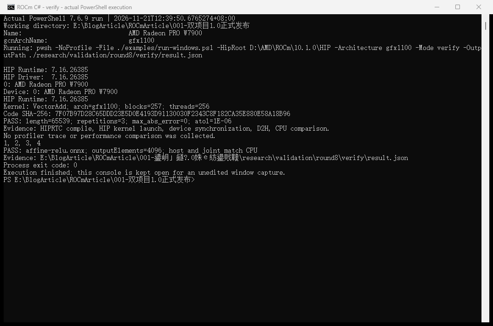
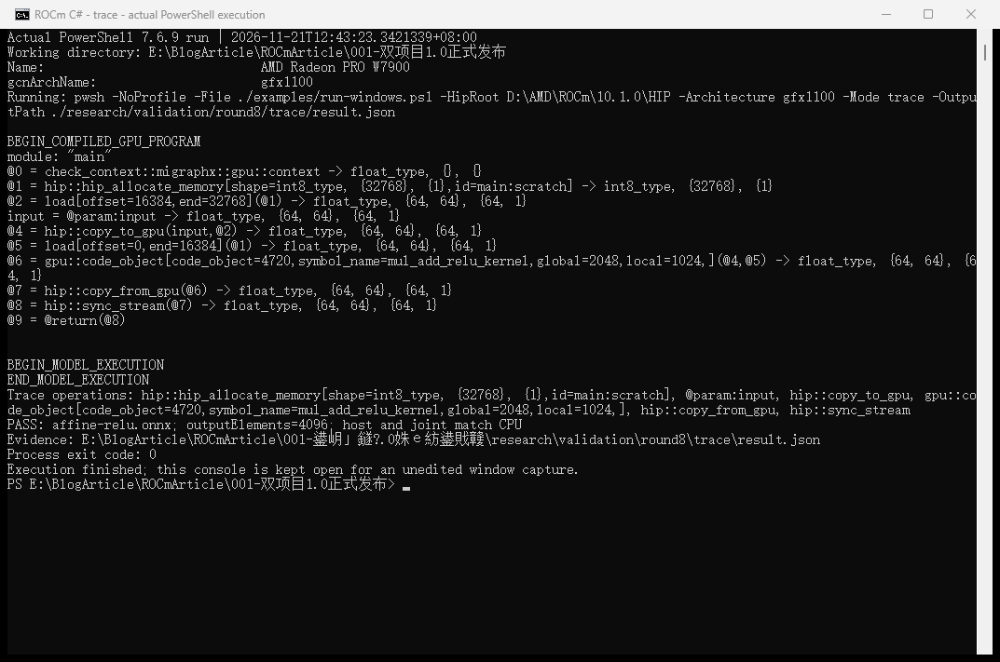
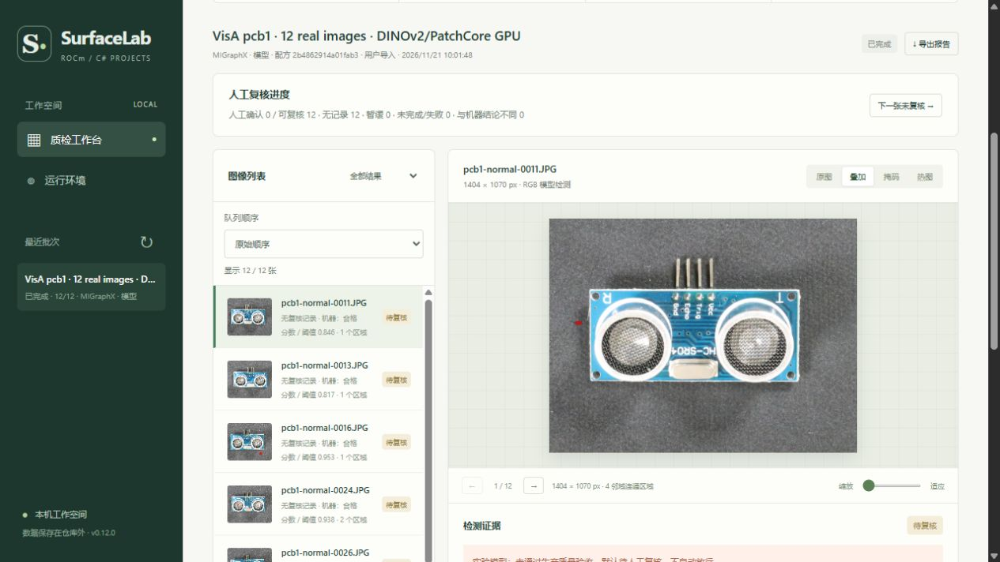
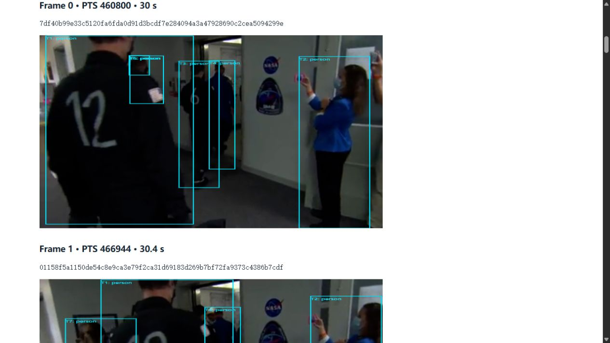

# C# 也能玩转 AMD GPU：从自定义计算到 AI 推理，让你的项目也加速起来

**用熟悉的 C#/.NET，调用 AMD GPU 做自定义计算、ONNX 推理和模型前后处理。**


*AIGC 概念封面，非实测截图。*

之前和大家分享过 OpenVINO、TensorRT 的 C# 接口，这次把 AMD GPU 也接进来。**HIP CSharp API 和 MIGraphX CSharp API 1.0.0 正式发布**，配套 Runtime 和 HIP 适配包已上架 NuGet。

做这些封装时，我主要考虑的是怎样接进现有 .NET 工程：除了运行模型，还要加载原生库、管理显存和异步任务，再把结果交给业务代码。两个项目围绕这些环节提供 C# 接口，让计算、推理和资源管理有一条连贯的使用路径。

面向使用 AMD 显卡的 C#/.NET 开发者，本文带你选包、跑通计算与模型推理，再看看怎样接进工业视觉、桌面 AI 和数据处理应用。

## 一、让你的 C# 项目用上 AMD GPU

- **批量计算交给 GPU**：将图像像素、信号采样和数组运算组织成并行任务，用自己的算法完成处理，再把结果接回现有业务流程。
- **ONNX 模型接进应用**：在 C# 中完成模型加载、编译和推理，将目标检测、OCR 等能力接进桌面界面或服务，推理运行时无需另起 Python 服务。
- **前后处理连成流水线**：HIP 处理数据布局和数值变换，MIGraphX 运行模型，中间数据可以继续留在设备上处理，由 C# 统一组织调用与资源。

## 二、为什么选择 HIP + MIGraphX？

**HIP 面向自己编写的并行计算，MIGraphX 面向已有的模型计算图。** 比如给图像做像素变换，可以从 HIP 开始；已有训练好的 ONNX 检测模型，则先用 MIGraphX 跑通推理，再按需要接入 HIP 前后处理。

| 你现在的需求 | 先选哪个 | 可以从哪里开始 |
| --- | --- | --- |
| 图像处理、数值计算或自定义并行算法 | HIP CSharp API | 设备、显存、HIPRTC、Module、Kernel、Stream/Event |
| 已有 ONNX，想在 .NET 中做推理 | MIGraphX CSharp API | 模型解析、计算图编译、张量输入输出、程序复用 |
| 前处理、模型、后处理一起组织 | 两个 Core + HIP.Interop | 同一 Stream、具名设备输入、设备输出与资源生命周期 |

两个 Core 可独立使用，联合处理时再加入 HIP.Interop：先完成一个计算步骤或一个模型，再逐步扩展整条流程。仓库内的模型示例覆盖检测、OCR、图文匹配和版面处理，也包含输入处理和结果解析，便于对照自己的任务修改：

```text
YOLO26、PaddleOCR v4/v5/v6、CLIP、PP-Structure 示例
https://github.com/guojin-yan/MIGraphX-CSharp-API/tree/v1.0.0/samples
```

## 三、HIP 与 MIGraphX：1.0.0 正式发布

这次发布的是两个各有分工、也能组合使用的开源库。下面重点说说它们能为 C# 开发带来哪些能力。

### HIP CSharp API：从 C# 调用自己的 GPU 算法

AMD HIP Runtime 与 HIPRTC 的 C#/.NET 接口库。**Kernel 使用 HIP C/C++ 编写，C# 负责数据传输、任务提交和资源管理**；常见流程使用托管对象，需要直接调用原生能力时，也有低层 API 入口。

- **自己的算法自己组织**：编写像素变换、信号处理或数组运算 Kernel，设置线程与网格，再从 C# 调用，适合已有业务中的批量计算步骤。
- **运行时编译与模块加载**：支持通过 HIPRTC 将 Kernel 源码编译成设备代码，也支持加载预编译模块，方便实验算法与部署已有计算程序。
- **显存与数据传输**：提供设备选择、显存分配和上传下载接口，让应用明确管理数据位置，按流程复用缓冲区。
- **异步执行与计时**：Stream 组织任务顺序，Event 用于同步与计时，便于把拷贝、计算和后续处理串起来。
- **符合 .NET 习惯的资源管理**：设备内存、Stream、Event、Module 等对象通过 `using` / `Dispose` 释放，异步在途资源有保活机制。
- **从示例逐步上手**：中英文 API 注释配合设备枚举、内存拷贝、VectorAdd、Stream/Event 等教程，先跑通再改成自己的算法。

### MIGraphX CSharp API：把 ONNX 模型接进 .NET 应用

AMD MIGraphX 的 C#/.NET 接口库。MIGraphX 将模型计算图编译为面向 AMD GPU 的程序，封装库把**模型加载、张量管理、编译与执行**接进 .NET，让推理与现有界面、数据处理和业务逻辑放在同一个应用中。

- **ONNX 模型接入**：从文件或内存解析模型，读取输入名称和形状，完成 GPU 编译后提交推理，适合把已有模型接进 C# 工程。
- **灵活的张量输入输出**：支持多输入输出、类型化张量和动态形状，结果可读取为 C# 数组，便于继续做解析与业务判断。
- **编译程序复用**：同一进程内复用已编译程序，避免每次请求都重建；另有保存、加载与缓存接口，跨进程行为和成本见第六节。
- **前后处理一起连接**：通过 HIP.Interop 接入 HIP Stream 与设备缓冲区，让前处理、模型执行和后处理按同一条流的顺序提交。
- **加载与兼容性诊断**：提供原生库加载路径、功能探测和诊断信息，配置环境时可以核对实际加载的引擎与可用接口。
- **四类工程示例**：YOLO26 检测与分割、PaddleOCR 文字识别、CLIP 图文匹配、PP-Structure 文档结构分析，提供可继续修改的工程起点。

两个库的托管目标覆盖 .NET Framework 4.6 至 .NET 10，配有中英文 API 注释；目标框架覆盖与 GPU 实测范围需分开看，本文运行示例和验证环境见后文。

**七个 NuGet 包已发布**，按用途选择：

Core 提供 C# 接口，平台 Runtime 提供对应原生运行库，HIP.Interop 负责连接两个 Core。这样既能选择随项目分发的 Runtime，也能按部署指南使用兼容的系统安装。

| NuGet 包 | 版本 | 职责 | 地址（可复制） |
| --- | --- | --- | --- |
| `JYPPX.ROCm.HIP.CSharp.API` | 1.0.0 | HIP 托管接口，Core 不包含显卡驱动 | `https://www.nuget.org/packages/JYPPX.ROCm.HIP.CSharp.API/1.0.0` |
| `JYPPX.ROCm.HIP.CSharp.API.Runtime.win-x64` | 10.1.0 | Windows HIP/HIPRTC 用户态运行库 | `https://www.nuget.org/packages/JYPPX.ROCm.HIP.CSharp.API.Runtime.win-x64/10.1.0` |
| `JYPPX.ROCm.HIP.CSharp.API.Runtime.ubuntu.24.04-x64` | 10.1.0 | Ubuntu 24.04 HIP/HIPRTC 用户态运行库 | `https://www.nuget.org/packages/JYPPX.ROCm.HIP.CSharp.API.Runtime.ubuntu.24.04-x64/10.1.0` |
| `JYPPX.ROCm.MIGraphX.CSharp.API` | 1.0.0 | ONNX 与 MIGraphX 托管接口 | `https://www.nuget.org/packages/JYPPX.ROCm.MIGraphX.CSharp.API/1.0.0` |
| `JYPPX.ROCm.MIGraphX.CSharp.API.HIP.Interop` | 1.0.0 | HIP Stream 和设备输入输出适配 | `https://www.nuget.org/packages/JYPPX.ROCm.MIGraphX.CSharp.API.HIP.Interop/1.0.0` |
| `JYPPX.ROCm.MIGraphX.CSharp.API.Runtime.win-x64` | 1.0.0 | Windows MIGraphX 2.18.0 引擎 | `https://www.nuget.org/packages/JYPPX.ROCm.MIGraphX.CSharp.API.Runtime.win-x64/1.0.0` |
| `JYPPX.ROCm.MIGraphX.CSharp.API.Runtime.ubuntu.24.04-x64` | 1.0.0 | Ubuntu MIGraphX 2.18.0 引擎 | `https://www.nuget.org/packages/JYPPX.ROCm.MIGraphX.CSharp.API.Runtime.ubuntu.24.04-x64/1.0.0` |

版本分别对应不同组件：**Core/适配器 `1.0.0`、HIP Runtime `10.1.0`、MIGraphX Runtime `1.0.0`（引擎 `2.18.0`）**。联合工程需一起核对版本，清理输出目录中的旧原生库。

**Windows MIGraphX 引擎由我基于 AMD 源码和 Windows 适配补丁构建，设备代码针对 gfx1100**；Ubuntu 引擎采用 AMD 二进制并调整 ELF 加载路径。源码身份、哈希与依赖见包内 `native-manifest.json`，第三方许可见 `licenses/`。

MIGraphX 还需要 **ROCm 10.1 的 HIP/HIPRTC、COMGR、MIOpen、rocBLAS、hipBLASLt、GPU 设备数据和 bitcode**。驱动另装，Windows 另需 VC++ x64 运行库；NuGet 不安装完整 ROCm。同一进程保持同一套原生库。

安装配置见下方指南。AMD 维护上游 HIP/MIGraphX，我维护 C# 封装与项目分发；项目发布与测试不代表 AMD 官方认证。

```text
MIGraphX 部署指南
https://github.com/guojin-yan/MIGraphX-CSharp-API/blob/v1.0.0/docs/guides/runtime-deployment.md

HIP Runtime 来源与分发说明
https://github.com/guojin-yan/HIP-CSharp-API/blob/b18bb40ef9b85a4c09747ea8b42e2382d261f0e3/docs/guides/runtime-distribution-10.1.0.md
```

## 四、从零运行，再验证计算结果

本文命令的实际 GPU 基线是 **Radeon PRO W7900 / gfx1100、Windows 11、ROCm 10.1、MIGraphX 2.18**。

### 先检查环境，按用途安装

示例使用 .NET 10。安装好上述依赖后，先确认 SDK 和设备：

```powershell
dotnet --list-sdks
Get-CimInstance Win32_VideoController | Select-Object Name, DriverVersion
```

按下面三条路径选包。本文实跑 Windows；Ubuntu 改用对应 Runtime 和 `linux-x64` RID，环境按部署指南配置。

| 路径 | 最少引用 | 下一步 |
| --- | --- | --- |
| HIP Kernel | HIP Core 1.0.0 + win Runtime 10.1.0，或兼容系统 HIP | HipHello、VectorAdd |
| ONNX 推理 | MIGraphX Core 1.0.0 + win 引擎包 1.0.0 + ROCm 系统依赖 | Identity、非平凡 ONNX |
| 联合流程 | 上述两个 Core + HIP.Interop 1.0.0，同一套原生环境 | Stream、设备 I/O、HIP 前后处理 |

例如先建一个 ONNX 工程：

```powershell
dotnet new console -n MyOnnx -f net10.0
cd MyOnnx
dotnet add package JYPPX.ROCm.MIGraphX.CSharp.API --version 1.0.0
dotnet add package JYPPX.ROCm.MIGraphX.CSharp.API.Runtime.win-x64 --version 1.0.0
# 需要联合处理时再加：
dotnet add package JYPPX.ROCm.HIP.CSharp.API --version 1.0.0
dotnet add package JYPPX.ROCm.MIGraphX.CSharp.API.HIP.Interop --version 1.0.0
```

也可以直接运行随文示例。在准备存放源码的目录打开 **PowerShell 7**：

```powershell
git clone https://github.com/guojin-yan/BlogArticle.git
Set-Location './BlogArticle'
$articleDir = (Resolve-Path './ROCmArticle/001-双项目1.0正式发布').Path
pwsh -File "$articleDir/examples/run-windows.ps1" -CheckOnly
pwsh -File "$articleDir/examples/run-windows.ps1" -Architecture gfx1100
```

已有仓库时，从根目录的 `$articleDir` 那行开始。脚本读取 `HIP_PATH`，未配置则提示输入你自己的 ROCm 10.1 HIP 目录（包含 `bin`、`lib`），也可用 `-HipRoot` 指定。

`-CheckOnly` 检查真实 gfx、HIPRTC、MIGraphX、模型及依赖，报告 `PASS / FAIL / SKIP / NOT CHECKED`，并记录 DLL 加载路径、版本和哈希差异。**预检通过后仍需实跑模型**；失败看 JSON 建议和下方故障表。

脚本只为当前进程配置路径，不改全局 PATH、不安装系统依赖。首次运行会还原 NuGet 包；`gfx1100` 按实际 GPU 和支持范围填写。

### 从设备到 HIP Kernel

HipHello 打印 Runtime、Driver 和设备名，实跑输出：

```text
HipHello
https://github.com/guojin-yan/BlogArticle/blob/main/ROCmArticle/001-双项目1.0正式发布/examples/HipHello/Program.cs
```

```text
HIP Runtime: 7.16.26385
HIP Driver:  7.16.26385
0: AMD Radeon PRO W7900
```

这里是原生库报告的版本号，与 NuGet 包版本不同。接着用 VectorAdd 计算 `c[i] = a[i] + b[i]`，完成上传、编译、执行、同步与下载，再逐元素对照 CPU。

它的作用是先验证一条完整的 HIP 调用链：能找到设备、编译 Kernel，并在 GPU 上得到正确结果。输出每轮预填 NaN，元素数量特意不取线程块大小的整数倍，用来发现漏写和尾部处理问题。

```text
VectorAdd
https://github.com/guojin-yan/BlogArticle/blob/main/ROCmArticle/001-双项目1.0正式发布/examples/HipVectorAdd/Program.cs
```

```text
Kernel: VectorAdd; arch=gfx1100; blocks=257; threads=256
PASS: length=65539; repetitions=3; max_abs_error=0; atol=1E-06
```



*2026-11-21，W7900/gfx1100 上实际运行的 PowerShell 7 窗口原图：设备枚举、VectorAdd、Identity 和 Affine/ReLU 均完成。*

```text
原始日志
https://github.com/guojin-yan/BlogArticle/blob/main/ROCmArticle/001-双项目1.0正式发布/research/validation/round8/verify/stdout-stderr.txt

截图采集记录（进程、时间、SHA256 与运行记录对应关系）
https://github.com/guojin-yan/BlogArticle/blob/main/ROCmArticle/001-双项目1.0正式发布/research/validation/round8/screenshots/manifest.json
```

### ONNX：先跑通 API，再检查真正的计算

Identity 示例的输入是 `float32[1,4]`、参数名 `input`，输出为：

```text
Identity 示例
https://github.com/guojin-yan/BlogArticle/blob/main/ROCmArticle/001-双项目1.0正式发布/examples/MigraphxHello/Program.cs
```

```text
1, 2, 3, 4
```

Identity 将输入原样输出，适合先检查原生库加载、模型解析、张量绑定与结果读取。但这类图可能被优化，输出正确尚不足以证明 GPU 执行了实际算术，因此还要继续验证下面的计算模型。

再用 MigraphxCompute 验证实际计算：固定 `float32[64,64]` 模型执行 `max(0, x × 0.5 + 0.25)`，模型与输入由固定公式生成。独立 C#、ONNX Runtime CPU、MIGraphX 主机 I/O 与 HIP 联合路径对照 **4,096 个输出，最大绝对误差均为 0**；预设容差为 `0.001 + 0.001 × abs(CPU参考)`。

这一步同时检查数值结果与两种数据入口：先用主机张量跑通模型，再用 HIP 设备缓冲区接入联合路径。换成自己的模型后，也建议保留 CPU 参考，先确认形状、布局和数值，再测耗时。

```text
MigraphxCompute
https://github.com/guojin-yan/BlogArticle/blob/main/ROCmArticle/001-双项目1.0正式发布/examples/MigraphxCompute/Program.cs

标准库生成器
https://github.com/guojin-yan/BlogArticle/blob/main/ROCmArticle/001-双项目1.0正式发布/examples/MigraphxCompute/generate-model.py
```

想看实际执行记录，在上面的终端继续执行：

```powershell
pwsh -File "$articleDir/examples/run-windows.ps1" -Mode trace
```

本轮编译图与执行跟踪出现了以下 GPU 指令：

```text
gpu::code_object[symbol_name=mul_add_relu_kernel,global=2048,local=1024,...]
hip::copy_from_gpu
hip::sync_stream
PASS: affine-relu.onnx; outputElements=4096; host and joint match CPU
```



*2026-11-21，PowerShell 实跑 `-Mode trace` 的窗口原图，显示编译图、执行跟踪和数值检查。*

执行跟踪、设备输入的同步运行与 CPU 对照，以及 HIP event 完成区间，共同核验这条 GPU 路径。RunTrace 是执行元数据，event 区间含 D2D 复制与排队，均不等于独立逐 Kernel Profiler；性能见第六节。

```text
实际执行跟踪
https://github.com/guojin-yan/BlogArticle/blob/main/ROCmArticle/001-双项目1.0正式发布/research/validation/round8/trace/stdout-stderr.txt

结果 JSON
https://github.com/guojin-yan/BlogArticle/blob/main/ROCmArticle/001-双项目1.0正式发布/research/validation/round8/trace/result.json
```

### 用一张真实照片完成目标检测

接着用 scikit-image 收录的 NASA 公有领域照片跑完整检测：**解码 → 缩放补边/BGR/CHW → MIGraphX → YOLOX 解码 → NMS → 原图坐标与结果导出**。

```powershell
$photoRoot = "$articleDir/.validation/photo"
New-Item -ItemType Directory -Force -Path "$photoRoot/inputs", "$photoRoot/results" | Out-Null
Invoke-WebRequest 'https://raw.githubusercontent.com/scikit-image/scikit-image/v0.19.3/skimage/data/astronaut.png' -OutFile "$photoRoot/inputs/astronaut.png"
Invoke-WebRequest 'https://github.com/Megvii-BaseDetection/YOLOX/releases/download/0.1.1rc0/yolox_nano.onnx' -OutFile "$photoRoot/inputs/yolox_nano.onnx"
# 模型与图片 SHA256 的核验命令见示例说明。
pwsh -File "$articleDir/examples/run-windows.ps1" -Mode detect -ModelPath "$photoRoot/inputs/yolox_nano.onnx" -ImagePath "$photoRoot/inputs/astronaut.png" -OutputPath "$photoRoot/results/photo.json"
```

W7900 实跑得到 **1 个 person，分数 0.9259**，301,665 个原始输出与 CPU 对照无超差。结果目录含带框 PNG、类别/分数/坐标 JSON 和 `detection-report.html`。人工查看框对应人物；此例无独立标注，只作功能演示，不报告 mAP。


*NASA / Eileen Collins，via scikit-image，公有领域。C# 根据 GPU 输出绘框；命令与哈希见第七轮记录。*


*第三轮采集的真实报告浏览器截图，呈现第二轮结果；第七轮复跑的带框 PNG 哈希一致。*

### 第一次运行失败，先查哪里？

| 现象 | 先检查什么 |
| --- | --- |
| 缺少 `amdhip64` / `hiprtc` | x64 进程、平台 Runtime、原生文件是否复制、SDK/PATH 与 HIP 加载诊断 |
| MIGraphX `ProbeSystem()` 失败 | `Diagnostics`、`LoadedPath`、RID 目录、GPU 插件及其依赖 |
| rocBLAS / hipBLASLt 初始化失败 | ROCm 家族、Tensile/gfx 目录；Windows 设备库路径使用反斜杠，随文脚本已统一处理 |
| HIPRTC 或 module 加载失败 | 实际 GPU 架构、`--arch`、完整编译日志与错误码 |
| 插件存在但不能加载 | 传递依赖；Ubuntu 还要核对符号链接和 helper 权限 |

环境变量、Ubuntu 配置、模型哈希与手动命令见配套说明。

```text
上手与验证
https://github.com/guojin-yan/BlogArticle/blob/main/ROCmArticle/001-双项目1.0正式发布/05-上手与验证.md

示例说明
https://github.com/guojin-yan/BlogArticle/blob/main/ROCmArticle/001-双项目1.0正式发布/examples/README.md
```

## 五、从模型走向业务流水线

模型跑通后，接下来要处理的是模型之外的工作。例如图片通常需要调整数据布局、归一化，输出还要做数值变换或筛选。HIP 负责这些自定义步骤，MIGraphX 负责模型执行，C# 将它们组织成一条业务流程。


*AIGC 架构示意图，非实测截图。*

联合示例执行 **主机 HWC float → H2D → HIP 转 CHW → MIGraphX → D2D → HIP clamp → D2H → 同步**。HWC、CHW 表示图像按像素或按通道排列；H2D 是主机到设备上传，D2H 是设备到主机下载，D2D 是设备内复制。

**这条路径的价值在于让中间步骤衔接在设备上**：布局变换后直接交给模型，模型结果继续交给 HIP 处理，最后再取回。HIP.Interop 在同一 Stream 上组织顺序，资源保留到任务完成。其中 `RunDeviceIntoAsync` 仍会复制输出到调用者缓冲区，有传输和同步成本，不能称为零拷贝。

下面四个应用展示业务用法，每例附源码与真实数据来源。卡通配图均为 **AIGC 流程示意图，非实测截图**；其后的工作台或报告图来自实际程序。

### SurfaceLab：工业图像检测与复核


串联图像批次、规则与异常模型检测、热图和人工复核，可导出报告，供质检工具开发参考。



*VisA pcb1（CC BY 4.0），DINOv2/PatchCore 经 MIGraphX GPU 处理 12 张真实图。固定阈值下，6 张正常图判合格；6 张异常图检出 3 张、漏检 3 张，均待人工复核，不代表生产精度。*

```text
https://github.com/guojin-yan/ROCm-CSharp-Projects/tree/2f70b96267484b441fa726a3d496b8cc55d47219/projects/IndustrialInspection

真实数据：Amazon Science VisA（Yang Zou 等），CC BY 4.0
https://github.com/amazon-science/spot-diff
```

### SignalDiagnostics：从离线信号到分析报告


用一个简单流程看 GPU 计算怎样接进应用：

- **输入**：UCI 液压系统 PS1 压力信号，首个 60 秒周期，100 Hz、6,000 点，单位 bar。
- **处理**：用 HIP FFT 分析频率成分，按规则找出待复核的时间段。
- **输出**：频谱、窗口 RMS 趋势和 HTML 报告，可回看样本、记录复核结果。


*原始压力数据未缩放或重采样。45 个窗口、5,805 个 PSD 值通过 CPU/HIP 对照，1 个窗口触发规则，尾部 112 点未分析；示例阈值不代表故障标准。*

```text
https://github.com/guojin-yan/ROCm-CSharp-Projects/tree/2f70b96267484b441fa726a3d496b8cc55d47219/projects/SignalDiagnostics

真实数据：Helwig、Pignanelli、Schütze，UCI 447，CC BY 4.0
https://archive.ics.uci.edu/dataset/447/condition+monitoring+of+hydraulic+systems
```

### DocumentEvidence：OCR 与文档核验


将 OCR 结果或指定行识别接入字段、金额核验，保留人工修正记录并导出报告。


*HierText / Open Images 真实招牌裁图（CC BY-SA 4.0）。指定两行区域后，GPU 读出 `APPLE`、`SODA`，与官方原文一致；仅展示行识别。*

```text
https://github.com/guojin-yan/ROCm-CSharp-Projects/tree/2f70b96267484b441fa726a3d496b8cc55d47219/projects/DocumentEvidence

真实数据：Long 等，Google Research HierText / Open Images，CC BY-SA 4.0
https://github.com/google-research-datasets/hiertext
```

### VideoEventSearch：按候选事件回看视频


为离线视频建立进入、越线、停留等候选事件索引，关联原帧与时间点，便于回看复核。



*NASA Demo-2 Walkout 公开视频，预先固定约 30–40 秒区间。25 帧经 MIGraphX GPU 产生 109 条检测、12 个待复核候选，框由程序输出绘制；无独立事件标注，不代表 NASA 认可项目。*

```text
https://github.com/guojin-yan/ROCm-CSharp-Projects/tree/2f70b96267484b441fa726a3d496b8cc55d47219/projects/VideoEventSearch

真实素材：NASA Image and Video Library，按 NASA 媒体使用指南引用
https://images.nasa.gov/details/KSC-20200530-MH-AJW02-0003-SpaceX_Demo-2_Walkout_Hallway_and_C7_Exit_4K
https://www.nasa.gov/nasa-brand-center/images-and-media/
```

## 六、验证结果与使用边界

### 平台验证

主要 GPU 基线：**W7900 / gfx1100、ROCm 10.1、MIGraphX 2.18**。

| 平台 | HIP 发布检查 | MIGraphX 发布检查 |
| --- | --- | --- |
| Windows x64 | 23 项通过，1 项能力跳过（managed memory） | 25 项 GPU 组合检查通过 |
| Ubuntu 24.04 / WSL2 | 21 项通过，2 项能力跳过（managed memory、arrays） | 7 组 / 30 项通过 |
| 原生 Linux / KFD | 当前正式组合未独立验证 | 当前正式组合未独立验证 |

2026-11-21 在 **Windows 11 / .NET 10** 用新检出、独立 NuGet/HTTP 缓存复验：预检、VectorAdd、Identity、Affine/ReLU、MatMul/ReLU、跟踪与真实照片检测通过。仍复用本机驱动和 SDK，无新系统或独立读者验收；WSL2 不代表原生 Linux，其他 GPU 需实测。

### 五轮实际模型测量

**Ryzen 9 5900XT + W7900**，YOLOX Nano ONNX，CPU 使用 ONNX Runtime 1.23.2，GPU 环境同上。固定合成 RGB 输入：float32、batch=1、`1×3×416×416`；输出统一 clamp。

| 路径 | 五轮 P50 中位数，ms | 各轮 P50 范围，ms |
| --- | --- | --- |
| ONNX Runtime CPU | 14.773 | 14.424–15.022 |
| MIGraphX，逐次创建 Host 参数 | 20.565 | 19.836–21.478 |
| Host 参数复用（仅固定输入重放） | 19.249 | 17.746–19.452 |
| Device I/O，CPU 前后处理 | 7.232 | 6.853–7.386 |
| HIP + MIGraphX，设备前后处理 | 5.228 | 5.053–5.397 |

这组数据说明，**接口的数据路径和前后处理方式值得一起优化**：本例中逐次创建 Host 参数的 GPU 路径耗时高于 CPU，改用 Device I/O、再衔接 HIP 前后处理后，整条路径的热态耗时降低。读者应结合下面的范围判断收益，再用自己的模型与输入复测。

**计时范围：已解码主机 HWC float → 主机后处理输出**，含传输、布局、同步和 clamp，**不含解码、NMS、模型编译与可复用缓冲区分配，不是完整检测耗时**。

- **测法**：2026-11-20，5 个独立进程，每路径预热 10 次、测量 30 次，逐次随机顺序；全部样本、P95 与旧两轮记录保留。
- **正确性**：四条 GPU 路径最终输出、Host/联合原始模型输出均无超差或非有限值；合成输入不评检测精度。
- **比较边界**：Host API 不能原地更新参数，复用行只代表固定输入重放；Device I/O 行保留传输和 CPU 前后处理，联合行改用 HIP。差值反映整体实现，不能全归因于 GPU 算子或零拷贝。

**热态之外，还要算启动成本：**

- **创建/编译中位数**：CPU Session **0.100 秒**，Host 图 **25.13 秒**，Device 图 **19.41 秒**，HIP **63 ms**。
- **进程内首次调用**：CPU **26.8–161.3 ms**，Host GPU **38.1–44.2 ms**，联合 GPU **20.3–21.5 ms**。
- **使用取舍**：长驻应用可复用程序，低频调用需计入启动；未清驱动/磁盘缓存，`cache-cold NOT TESTED`。

### 接入前留意

- **兼容性**：随文脚本已修正 Windows hipBLASLt 路径分隔符，MatMul、PCB 模型与 OCR 重新通过编译；小 INT8 未复跑，Windows 引擎不含 TensorFlow importer。
- **缓存**：未编译图跨进程命中后仍需 **27–32 秒**编译；中文路径保存、已编译 YOLOX 图载入后重编译失败，不能承诺命中即免编译。
- **测量限制**：无独立 Kernel Profiler、干净冷启动或进程峰值显存数据，未锁 GPU 时钟与功耗。
- **应用验证**：第三轮 264 项测试通过；四案例保留漏检、错字与待复核事件，视频仍有 MIOpen/rocBLAS 候选错误日志。业务精度与生产验收需另验。

完整数据、近零值误差解释、预检范围与失败日志见配套资料：

```text
上手与验证
https://github.com/guojin-yan/BlogArticle/blob/main/ROCmArticle/001-双项目1.0正式发布/05-上手与验证.md

第二轮复测与修订说明
https://github.com/guojin-yan/BlogArticle/blob/main/ROCmArticle/001-双项目1.0正式发布/research/issue-2-修订说明.md

四个案例的真实数据、运行结果与截图
https://github.com/guojin-yan/BlogArticle/blob/main/ROCmArticle/001-双项目1.0正式发布/research/真实开源数据案例与截图.md

Issue #2 逐项修改与验收记录
https://github.com/guojin-yan/BlogArticle/blob/main/ROCmArticle/001-双项目1.0正式发布/research/issue-2-当前验收对照.md
```

## 七、下一步：接入你自己的项目

建议按这个顺序上手：

- **先跑 VectorAdd**：应看到 `max_abs_error=0`，再替换自己的 Kernel。
- **再跑 ONNX 数值对照**：Identity 输出 `1, 2, 3, 4`，Affine/ReLU 显示 4,096 元素通过。
- **最后换自己的图片或业务数据**：沿用真实照片流程，检查框、分数和 CPU/GPU 输出，再测完整业务耗时。

可复制地址如下，运行命令见第四节：

```text
VectorAdd
https://github.com/guojin-yan/BlogArticle/blob/main/ROCmArticle/001-双项目1.0正式发布/examples/HipVectorAdd/Program.cs

ONNX 数值对照
https://github.com/guojin-yan/BlogArticle/blob/main/ROCmArticle/001-双项目1.0正式发布/examples/MigraphxCompute/README.md

真实图片与完整示例
https://github.com/guojin-yan/BlogArticle/blob/main/ROCmArticle/001-双项目1.0正式发布/examples/README.md
```

欢迎试用、Star，或提 Issue、补充设备与模型验证。反馈请附**环境版本、原生库路径、最小复现和输入、预期/实际结果及日志**，模板见配套说明。

```text
HIP
https://github.com/guojin-yan/HIP-CSharp-API

MIGraphX
https://github.com/guojin-yan/MIGraphX-CSharp-API

ROCm C# 应用集合
https://github.com/guojin-yan/ROCm-CSharp-Projects

文章反馈
https://github.com/guojin-yan/BlogArticle/issues
```

项目源码采用 Apache-2.0；原生组件、模型、数据、文章和配图按各自授权使用，分发时保留相应许可与来源通知。

Copyright © 2026 Guojin Yan / 椒颜皮皮虾。
