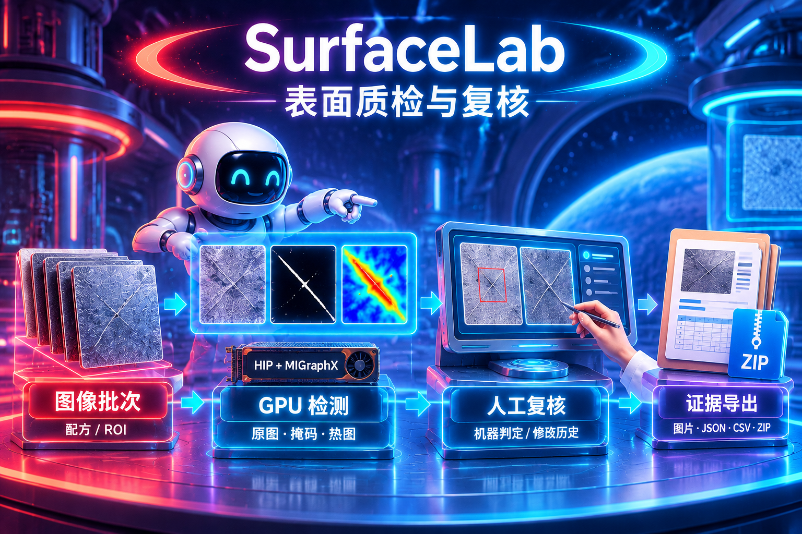
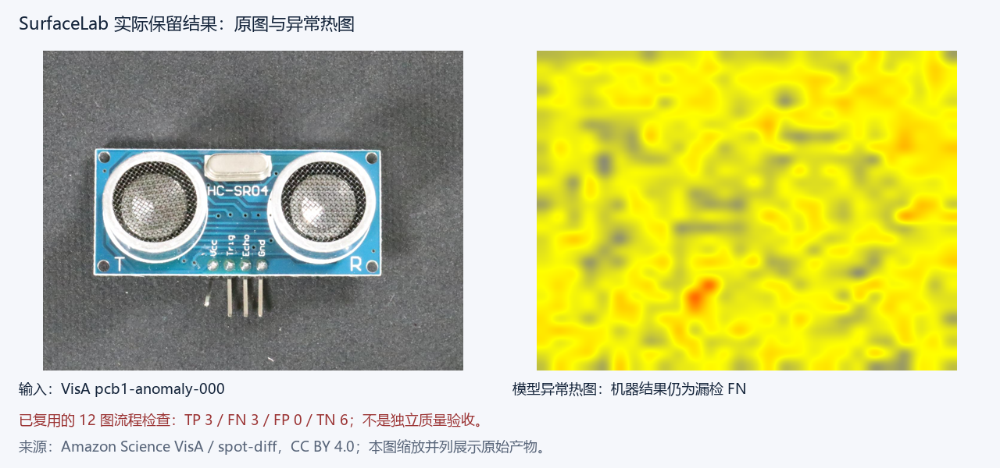
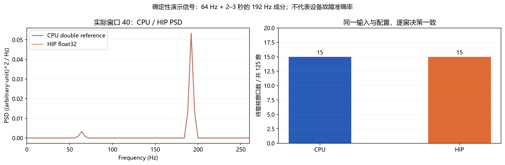
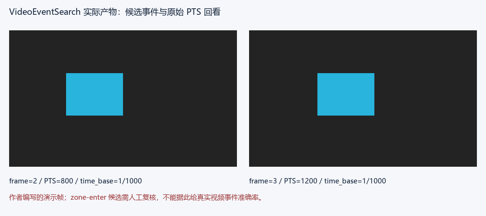

# C# 也能玩转 AMD GPU：从自定义计算到 AI 推理，让你的项目也加速起来

**用熟悉的 C#/.NET，调用 AMD GPU 做自定义计算、ONNX 推理和模型前后处理。**


之前和大家分享过 OpenVINO、TensorRT 的 C# 接口，这次轮到 AMD GPU 了。**HIP CSharp API 和 MIGraphX CSharp API 的 1.0.0 正式版已经发布**，配套平台 Runtime 和 HIP 适配包也已上架 NuGet。

如果你正在用 C#/.NET 开发工业视觉、桌面 AI 或数据处理应用，想自己写 GPU Kernel，或者把 ONNX 模型接进现有工程，这篇就带大家从选包、检查环境开始，完成第一次运行和数值验证，再看看怎样组合成应用。

## 一、让你的 C# 项目用上 AMD GPU

接入这两个项目后，C# 应用可以用 AMD GPU 完成三类工作。

**把批量计算交给 GPU。** 图像像素、信号采样和数组中经常有大量相同的计算。通过 HIP，可以编写自己的并行算法，再由 C# 上传数据、调用 GPU 计算并取回结果，把这部分能力接进现有业务代码。

**把 AI 模型接进 C# 应用。** 已有 ONNX 模型，可以通过 MIGraphX 在 C# 中完成加载、编译和推理，再把输出交给自己的界面或业务流程。项目里的目标检测、文字识别、图文匹配等示例，也提供了可以继续修改的工程起点。

**把模型前后处理一起串起来。** HIP 负责数据布局和数值处理，MIGraphX 负责模型推理，推理结果再交给 HIP 继续处理。这样可以把前处理、推理和后处理组织成一条 GPU 流程，中间数据继续留在设备上处理，由 C# 统一管理调用和资源。

从一个计算步骤开始，到接入一个模型，再到组织完整处理流程，都可以继续放在熟悉的 .NET 工程里完成。

## 二、为什么选择 HIP + MIGraphX？

两个项目各有分工：**HIP 组织自己写的 GPU 计算，MIGraphX 编译和运行已有模型，HIP.Interop 负责需要时把两者接起来。**

| 你现在的需求 | 先选哪个 | 可以从哪里开始 |
| --- | --- | --- |
| 图像处理、数值计算或自定义并行算法 | HIP CSharp API | 设备、显存、HIPRTC、Module、Kernel、Stream/Event |
| 已有 ONNX，想在 .NET 中做推理 | MIGraphX CSharp API | 模型解析、计算图编译、张量输入输出、程序复用 |
| 前处理、模型、后处理一起组织 | 两个 Core + HIP.Interop | 同一 Stream、具名设备输入、设备输出与资源生命周期 |

HIP Kernel 使用 HIP C/C++ 编写，C# 负责调用和资源管理。我保留了托管对象和低层 API 两条入口：常见任务可以用 `IDisposable` 管理设备资源，需要深入原生能力时，再往下使用对应接口。HIPRTC 用于在运行时把 Kernel 源码编译成设备代码。

MIGraphX 提供 ONNX 解析、编译、执行，以及动态形状、程序保存/加载和模型缓存等接口。仓库还有 YOLO26、PaddleOCR v4/v5/v6、CLIP、PP-Structure 示例，可以继续看检测、OCR、图文匹配和版面处理。

```text
YOLO26、PaddleOCR v4/v5/v6、CLIP、PP-Structure 示例
https://github.com/guojin-yan/MIGraphX-CSharp-API/tree/v1.0.0/samples
```

两个 Core 可以独立使用。只有需要连接 HIP Stream 和设备缓冲区时，才加入适配器；刚开始不必把全部包都装上。

## 三、HIP 与 MIGraphX：1.0.0 正式发布

这次带来两个开源项目：**HIP CSharp API 做自定义 GPU 计算，MIGraphX CSharp API 做 AI 模型推理。** 两者都能通过 NuGet 接入现有 C# 工程。

### HIP CSharp API：从 C# 调用自己的 GPU 算法

AMD HIP Runtime 与 HIPRTC 的 C#/.NET 接口库，提供托管对象和低层 API 两种入口。

- **自己写 GPU 算法**：用 HIP C/C++ 编写 Kernel，由 C# 调用，接入图像、信号和数值处理。
- **运行时编译**：通过 HIPRTC 编译 Kernel，也能直接加载预编译的设备模块。
- **显存与数据传输**：设备选择、显存分配、数据上传下载，都有对应接口。
- **异步执行与计时**：通过 Stream/Event 安排计算任务、同步结果、测量执行时间。
- **熟悉的资源管理**：使用 `using` / `Dispose` 管理资源，异步在途资源有保活机制。
- **现成教程与示例**：中英文 API 注释，配有设备枚举、内存拷贝、VectorAdd 等可运行示例。

### MIGraphX CSharp API：把 ONNX 模型接进 .NET 应用

AMD MIGraphX 的 C#/.NET 接口库，覆盖模型加载、张量管理、GPU 编译与推理。

- **ONNX 模型直接接入**：从文件或内存加载模型，在 C# 中完成 GPU 编译和执行。
- **灵活的输入输出**：支持多输入输出、类型化张量和动态输入形状，结果可读取为 C# 数组。
- **模型编译后复用**：支持程序保存、加载和显式缓存，在兼容环境中复用编译结果。
- **前处理、推理、后处理串联**：通过 HIP.Interop，在同一 HIP Stream 上连接设备缓冲区与计算任务。
- **四类工程示例**：YOLO26 检测与分割、PaddleOCR 文字识别、CLIP 图文匹配、PP-Structure 文档结构分析。

两个 Core 可独立引用，联合流程再加入 HIP.Interop。**七个 NuGet 包已发布**，按用途选择即可：

| NuGet 包 | 版本 | 职责 | 地址（可复制） |
| --- | --- | --- | --- |
| `JYPPX.ROCm.HIP.CSharp.API` | 1.0.0 | HIP 托管接口，Core 不包含显卡驱动 | `https://www.nuget.org/packages/JYPPX.ROCm.HIP.CSharp.API/1.0.0` |
| `JYPPX.ROCm.HIP.CSharp.API.Runtime.win-x64` | 10.1.0 | Windows HIP/HIPRTC 用户态运行库 | `https://www.nuget.org/packages/JYPPX.ROCm.HIP.CSharp.API.Runtime.win-x64/10.1.0` |
| `JYPPX.ROCm.HIP.CSharp.API.Runtime.ubuntu.24.04-x64` | 10.1.0 | Ubuntu 24.04 HIP/HIPRTC 用户态运行库 | `https://www.nuget.org/packages/JYPPX.ROCm.HIP.CSharp.API.Runtime.ubuntu.24.04-x64/10.1.0` |
| `JYPPX.ROCm.MIGraphX.CSharp.API` | 1.0.0 | ONNX 与 MIGraphX 托管接口 | `https://www.nuget.org/packages/JYPPX.ROCm.MIGraphX.CSharp.API/1.0.0` |
| `JYPPX.ROCm.MIGraphX.CSharp.API.HIP.Interop` | 1.0.0 | HIP Stream 和设备输入输出适配 | `https://www.nuget.org/packages/JYPPX.ROCm.MIGraphX.CSharp.API.HIP.Interop/1.0.0` |
| `JYPPX.ROCm.MIGraphX.CSharp.API.Runtime.win-x64` | 1.0.0 | Windows MIGraphX 2.18.0 引擎 | `https://www.nuget.org/packages/JYPPX.ROCm.MIGraphX.CSharp.API.Runtime.win-x64/1.0.0` |
| `JYPPX.ROCm.MIGraphX.CSharp.API.Runtime.ubuntu.24.04-x64` | 1.0.0 | Ubuntu MIGraphX 2.18.0 引擎 | `https://www.nuget.org/packages/JYPPX.ROCm.MIGraphX.CSharp.API.Runtime.ubuntu.24.04-x64/1.0.0` |

注意区分三个版本：C# Core/适配器是 `1.0.0`，HIP Runtime 包是 `10.1.0`，MIGraphX Runtime 包是 `1.0.0`、内部引擎是 `2.18.0`。升级联合工程时，两个 Core 和适配器一起核对，避免输出目录残留旧原生库。

**Windows MIGraphX 引擎是我基于 AMD 源码、加入 Windows 适配补丁构建的版本**，随项目 Runtime 分发，设备代码针对 gfx1100。Ubuntu 引擎采用 AMD 二进制并调整 ELF 加载路径。包内 `native-manifest.json` 保留源码身份、版本、文件哈希和主机依赖，`licenses/` 保留第三方许可。

MIGraphX 引擎包需要配合 **ROCm 10.1 的 HIP/HIPRTC、COMGR、MIOpen、rocBLAS、hipBLASLt、GPU 设备数据和 bitcode**；显卡驱动另装，Windows 还需要 VC++ x64 运行库。NuGet 不安装完整 ROCm，也不替换驱动。同一进程内保持同一套原生库家族。

安装前先看 MIGraphX 部署指南和 HIP Runtime 来源与分发说明。AMD 维护上游 HIP/MIGraphX，我维护 C# 封装和本项目分发工作；本项目的发布与测试不能理解为 AMD 官方认证。

```text
MIGraphX 部署指南
https://github.com/guojin-yan/MIGraphX-CSharp-API/blob/v1.0.0/docs/guides/runtime-deployment.md

HIP Runtime 来源与分发说明
https://github.com/guojin-yan/HIP-CSharp-API/blob/b18bb40ef9b85a4c09747ea8b42e2382d261f0e3/docs/guides/runtime-distribution-10.1.0.md
```

## 四、从零运行，再验证计算结果

本次核验日期为 **2026-11-19**，本文命令的实际 GPU 基线是 **Radeon PRO W7900 / gfx1100、Windows 11、ROCm 10.1、MIGraphX 2.18**。项目的 Ubuntu 24.04 / WSL2 发布验证列在第六节。

### 先检查环境，按用途安装

本文工程目标为 .NET 10。安装好系统依赖后，先确认 SDK 和设备：

```powershell
dotnet --list-sdks
Get-CimInstance Win32_VideoController | Select-Object Name, DriverVersion
```

从空目录创建工程时，按下面三条路径选包。Windows 是本文实跑路径；Ubuntu 使用表中的对应 Runtime、`linux-x64` RID，并按 Linux 部署指南配置驱动和库。

| 路径 | 最少引用 | 下一步 |
| --- | --- | --- |
| HIP Kernel | HIP Core 1.0.0 + win Runtime 10.1.0，或兼容系统 HIP | HipHello、VectorAdd |
| ONNX 推理 | MIGraphX Core 1.0.0 + win 引擎包 1.0.0 + ROCm 系统依赖 | Identity、非平凡 ONNX |
| 联合流程 | 上述两个 Core + HIP.Interop 1.0.0，同一套原生环境 | Stream、设备 I/O、HIP 前后处理 |

例如先建一个 ONNX 工程：

```powershell
dotnet new console -n MyOnnx -f net10.0
cd MyOnnx
dotnet add package JYPPX.ROCm.MIGraphX.CSharp.API --version 1.0.0
dotnet add package JYPPX.ROCm.MIGraphX.CSharp.API.Runtime.win-x64 --version 1.0.0
# 需要联合处理时再加：
dotnet add package JYPPX.ROCm.HIP.CSharp.API --version 1.0.0
dotnet add package JYPPX.ROCm.MIGraphX.CSharp.API.HIP.Interop --version 1.0.0
```

想先看完整运行结果，可以直接下载或克隆文章仓库。先安装 .NET SDK、兼容驱动、VC++ x64 运行库和 ROCm 10.1 系统依赖，再从 **BlogArticle 仓库根目录** 执行下面命令，把 SDK 路径和架构改为自己的配置。

```text
文章仓库
https://github.com/guojin-yan/BlogArticle
```

```powershell
pwsh -File './ROCmArticle/001-双项目1.0正式发布/examples/run-windows.ps1' -HipRoot 'D:/AMD/ROCm/10.1.0/HIP' -Architecture gfx1100
```

包装脚本只为当前进程配置 ROCm 路径，然后依次检查下面四项；首次运行包括 NuGet 还原，驱动和 SDK 安装时间需另外预留。

### 从设备到 HIP Kernel

HipHello 会打印 Runtime、Driver 和设备名。我本机是：

```text
HipHello
https://github.com/guojin-yan/BlogArticle/blob/main/ROCmArticle/001-双项目1.0正式发布/examples/HipHello/Program.cs
```

```text
HIP Runtime: 7.16.26385
HIP Driver:  7.16.26385
0: AMD Radeon PRO W7900
```

原生库报告的版本号与 NuGet 分发版本分开解释。枚举设备后，VectorAdd 会执行 `c[i] = a[i] + b[i]`：上传固定输入、编译 Kernel、启动、同步、下载，再与 CPU 逐元素比较。每轮输出预填 NaN，尾部元素和漏写结果也会检查。

```text
VectorAdd
https://github.com/guojin-yan/BlogArticle/blob/main/ROCmArticle/001-双项目1.0正式发布/examples/HipVectorAdd/Program.cs
```

```text
Kernel: VectorAdd; arch=gfx1100; blocks=257; threads=256
PASS: length=65539; repetitions=3; max_abs_error=0; atol=1E-06
```

这是实际执行结果，原始日志还保留生成代码的哈希。架构参数按实际 GPU 填写。

```text
原始日志
https://github.com/guojin-yan/BlogArticle/blob/main/ROCmArticle/001-双项目1.0正式发布/research/validation/issue1-vectoradd-run.log
```

### ONNX：先跑通 API，再检查真正的计算

Identity 示例的输入是 `float32[1,4]`、参数名 `input`，输出为：

```text
Identity 示例
https://github.com/guojin-yan/BlogArticle/blob/main/ROCmArticle/001-双项目1.0正式发布/examples/MigraphxHello/Program.cs
```

```text
1, 2, 3, 4
```

它是 **Loader/API/模型执行链路的 Smoke Test**。Identity 图可能被优化，正确输出和 `target="gpu"` 都不能单独证明 GPU Kernel 做了非平凡计算，更不能证明性能提升。

接着运行 MigraphxCompute。随文模型是固定 `float32[64,64]`，公式为 `max(0, x × 0.5 + 0.25)`，由标准库生成器生成；输入也由固定公式生成。它比较独立 C# 公式、ONNX Runtime CPU、MIGraphX 主机 I/O 和 HIP 联合路径的全部 4,096 个输出，容差预先固定为 `0.001 + 0.001 × abs(CPU参考)`，本轮最大绝对误差均为 0。

```text
MigraphxCompute
https://github.com/guojin-yan/BlogArticle/blob/main/ROCmArticle/001-双项目1.0正式发布/examples/MigraphxCompute/Program.cs

标准库生成器
https://github.com/guojin-yan/BlogArticle/blob/main/ROCmArticle/001-双项目1.0正式发布/examples/MigraphxCompute/generate-model.py
```

想看实际执行记录，在仓库根目录执行：

```powershell
pwsh -File './ROCmArticle/001-双项目1.0正式发布/examples/run-windows.ps1' -HipRoot 'D:/AMD/ROCm/10.1.0/HIP' -Mode trace
```

本轮编译图与执行跟踪出现了以下 GPU 指令：

```text
gpu::code_object[symbol_name=mul_add_relu_kernel,global=2048,local=1024,...]
hip::copy_from_gpu
hip::sync_stream
PASS: affine-relu.onnx; outputElements=4096; host and joint match CPU
```

这里有三组相互配合的证据：实际执行跟踪、仅使用设备输入的同步运行与 CPU 数值对照，以及包围模型和 D2D 复制的 HIP event 完成区间，见结果 JSON。RunTrace 是执行元数据，event 区间包含复制与排队，二者均不提供独立的逐 Kernel Profiler 时间线。这些记录用于核验该固定计算的 GPU 路径；性能另外测量。

```text
实际执行跟踪
https://github.com/guojin-yan/BlogArticle/blob/main/ROCmArticle/001-双项目1.0正式发布/research/validation/issue1-affine-trace.log

结果 JSON
https://github.com/guojin-yan/BlogArticle/blob/main/ROCmArticle/001-双项目1.0正式发布/research/validation/issue1-affine-result.json
```

### 第一次运行失败，先查哪里？

| 现象 | 先检查什么 |
| --- | --- |
| 缺少 `amdhip64` / `hiprtc` | x64 进程、平台 Runtime、原生文件是否复制、SDK/PATH 与 HIP 加载诊断 |
| MIGraphX `ProbeSystem()` 失败 | `Diagnostics`、`LoadedPath`、RID 目录、GPU 插件及其依赖 |
| rocBLAS / hipBLASLt 初始化失败 | ROCm 家族是否一致、Tensile/gfx 设备数据目录是否完整 |
| HIPRTC 或 module 加载失败 | 实际 GPU 架构、`--arch`、完整编译日志与错误码 |
| 插件存在但不能加载 | 传递依赖；Ubuntu 还要核对符号链接和 helper 权限 |

具体环境变量、Ubuntu 包替换、模型哈希及手动运行命令，见上手与验证和示例说明。

```text
上手与验证
https://github.com/guojin-yan/BlogArticle/blob/main/ROCmArticle/001-双项目1.0正式发布/05-上手与验证.md

示例说明
https://github.com/guojin-yan/BlogArticle/blob/main/ROCmArticle/001-双项目1.0正式发布/examples/README.md
```

## 五、从模型走向业务流水线

把模型跑通后，还可以继续把前后处理接进 GPU：HIP 做布局变换和数值处理，MIGraphX 运行模型，HIP 再做筛选，最后取回业务需要的结果。


*两个 Core 独立使用；需要 HIP Stream 和设备缓冲区时，再加入 HIP.Interop。*

本文联合示例实际做了 **主机 HWC float 输入 → H2D → HIP 转 CHW → MIGraphX → D2D 输出复制 → HIP clamp → D2H → 同步**。`RunDeviceIntoAsync` 会复制输出到调用者缓冲区，不能把它称为零拷贝。只要最后仍需完整输出，下载成本就仍在；收益要结合传输、同步、Kernel 启动、缓冲区复用和托管调用开销一起看。

我还做了四个应用参考。这里选信号分析展开，另外三个先用一张表说明用途与实际状态：

| 应用与源码 | 可以参考什么 | 需要单独验收什么 |
| --- | --- | --- |
| SurfaceLab<br>`https://github.com/guojin-yan/ROCm-CSharp-Projects/tree/2f70b96267484b441fa726a3d496b8cc55d47219/projects/IndustrialInspection` | 图像批次、缺陷叠加/热图、人工复核与证据报告 | 真实缺陷的漏检与误报；实验模型未达到质量目标，保留人工复核 |
| DocumentEvidence<br>`https://github.com/guojin-yan/ROCm-CSharp-Projects/tree/2f70b96267484b441fa726a3d496b8cc55d47219/projects/DocumentEvidence` | 已有 OCR 结果或指定文字行识别，字段/金额核验与纠正历史 | 自动整页检测、真实字段精度；指定行识别不等于完成整页自动识别 |
| VideoEventSearch<br>`https://github.com/guojin-yan/ROCm-CSharp-Projects/tree/2f70b96267484b441fa726a3d496b8cc55d47219/projects/VideoEventSearch` | 原始 PTS、检测跟踪、区域/越线/停留候选与原帧回看 | 独立人工事件标注；没有据此建立事件准确率 |



*SurfaceLab 流程概念图。下面补充实际保留的输入与模型热图，二者分开阅读。*



*真实产物来自已复用的 12 图流程检查，图中异常样本是 FN，仍需人工复核；全组 TP 3、FN 3、FP 0、TN 6。来源：Amazon Science VisA / spot-diff，CC BY 4.0；缩放并列展示，见来源记录。另一项 pcb2 首次类别测试为召回 73%、正常误报 6%，未达到 99%/10% 目标，见实际失败清单。*

```text
VisA / spot-diff
https://github.com/amazon-science/spot-diff

来源记录
https://github.com/guojin-yan/BlogArticle/blob/main/ROCmArticle/001-双项目1.0正式发布/research/validation/issue1-surfacelab-evidence.json

实际失败清单
https://github.com/guojin-yan/BlogArticle/blob/main/ROCmArticle/001-双项目1.0正式发布/research/validation/issue1-surfacelab-quality.json
```

### SignalDiagnostics：把一条输入走到可复核的报告


*这是流程概念图。实际示例读取 CSV，使用 HIP FFT，并将频谱、PSD、窗口规则与原始样本关联。*

SignalDiagnostics 不依赖 MIGraphX。先用可控输入把数值和业务流程看清：8 秒、4096 Hz，64 Hz 基础成分，2–3 秒加入 192 Hz；单位是 `arbitrary-unit`，这是一条作者编写的演示信号。

```text
SignalDiagnostics
https://github.com/guojin-yan/ROCm-CSharp-Projects/tree/2f70b96267484b441fa726a3d496b8cc55d47219/projects/SignalDiagnostics
```

下载应用仓库，固定本文使用的提交，从其仓库根目录运行：

```powershell
git checkout --detach 2f70b96267484b441fa726a3d496b8cc55d47219
dotnet run --project projects/SignalDiagnostics/src/Signal.App -c Release -- demo --output ../runs/article-signal/cpu
# 在已配置好 HIP 的终端继续：
$env:SIGNAL_GPU_ARCH = 'gfx1100'
dotnet run --project projects/SignalDiagnostics/src/Signal.App -c Release -- verify-gpu
dotnet run --project projects/SignalDiagnostics/src/Signal.App -c Release -- demo --hip --output ../runs/article-signal/hip
```

程序打印独立输出目录，其中有输入 CSV、配置、逐窗 CSV、`result.json` 和 HTML 报告。我实际运行后，CPU/HIP 都得到 **125 个完整窗口、15 个待复核窗口**，输入和配置哈希、每窗位置及决策一致。64,125 个 PSD 值的最大绝对差是 `7.403744700651416e-9`，满足预设容差；12 组 FFT 数值检查也通过，见对照摘要、完整 PSD 数值对和 GPU 检查日志。

```text
对照摘要
https://github.com/guojin-yan/BlogArticle/blob/main/ROCmArticle/001-双项目1.0正式发布/research/validation/issue1-signal-comparison.json

完整 PSD 数值对
https://github.com/guojin-yan/BlogArticle/blob/main/ROCmArticle/001-双项目1.0正式发布/research/validation/issue1-signal-psd.csv.gz

GPU 检查日志
https://github.com/guojin-yan/BlogArticle/blob/main/ROCmArticle/001-双项目1.0正式发布/research/validation/issue1-signal-gpu-check.log
```



换成自己的信号时，从 CSV 的 `time_s,value`、真实采样率、单位和窗参数开始，再比较 CPU/HIP 数值。需要回看某窗，就按样本范围定位原始信号，用 `review` 命令追加复核记录，保留机器结果。频段命中说明值得检查，不能直接给设备贴上故障标签。本例验证数值与软件流程，现场诊断准确率、长期运行和工业验收仍需另外完成。


*DocumentEvidence 流程概念图。已有结果导入、指定行 OCR、自动页面检测是不同入口。历史 7 条作者英文行测试中 6 条完全匹配，另一条多了前导空格；这不是独立真实文档精度验收，见原始范围和失败样例。*

```text
原始范围和失败样例
https://github.com/guojin-yan/BlogArticle/blob/main/ROCmArticle/001-双项目1.0正式发布/research/validation/issue1-document-evidence.json
```


*VideoEventSearch 流程概念图。下面是作者演示数据的实际 PTS 与事件证据，不能代替真实视频标注评估。*



*保留 `zone-enter` 候选的原帧和 PTS，并标为 NeedsReview，见事件记录。真实视频缺独立事件标签时，不给事件准确率，也不把“0 个候选”解释为没有事件。*

```text
事件记录
https://github.com/guojin-yan/BlogArticle/blob/main/ROCmArticle/001-双项目1.0正式发布/research/validation/issue1-video-evidence.json
```

## 六、已验证平台、性能与已知限制

### 先看自己的机器是否在证据范围内

下面把包发布验证与本篇新增运行分开。`PASS`、能力跳过 `SKIP`、未测 `NOT TESTED` 和已知失败 `KNOWN FAIL` 各有含义，跳过项不计作通过。

| 平台 / 对象 | 硬件与原生组合 | 正式包 | 已有证据 |
| --- | --- | --- | --- |
| Windows x64 / HIP | W7900 / gfx1100；ROCm/HIP Runtime 10.1 | Core 1.0.0 + Runtime 10.1.0 | PASS 23 / SKIP 1（managed memory），含 net48、RID、VectorAdd；来源<br>`https://github.com/guojin-yan/HIP-CSharp-API/blob/b18bb40ef9b85a4c09747ea8b42e2382d261f0e3/docs/compatibility/platforms.md` |
| Ubuntu 24.04 / WSL2 / HIP | W7900 / gfx1100；宿主驱动桥接；Runtime 10.1 | Core 1.0.0 + Runtime 10.1.0 | PASS 21 / SKIP 2（managed memory、arrays）；来源<br>`https://github.com/guojin-yan/HIP-CSharp-API/blob/b18bb40ef9b85a4c09747ea8b42e2382d261f0e3/docs/compatibility/platforms.md` |
| Windows 11 / MIGraphX | W7900 / gfx1100；ROCm 10.1 / MIGraphX 2.18 | Core、Interop、引擎包 1.0.0；HIP Core 1.0.0 | 发布记录 PASS 25 项 GPU 组合检查；来源<br>`https://github.com/guojin-yan/MIGraphX-CSharp-API/blob/v1.0.0/docs/release-notes/1.0.0.md` |
| Ubuntu 24.04 / WSL2 / MIGraphX | W7900 / gfx1100；ROCm 10.1 / MIGraphX 2.18 | 同上，使用 Ubuntu 引擎包 | 发布记录 PASS 7 组 / 30 项；来源<br>`https://github.com/guojin-yan/MIGraphX-CSharp-API/blob/v1.0.0/docs/release-notes/1.0.0.md` |
| 原生 Linux / KFD，当前正式组合 | 需独立驱动、设备节点与验证 | 当前 1.0 组合 | NOT TESTED：上述 WSL2 结果不外推；旧 ROCm 7.2.1 / MIGraphX 2.15 资料保留为历史 |
| 本文新增 Windows 运行 | Windows 11 10.0.26300；驱动 32.0.21030.2001；W7900/gfx1100；ROCm 10.1 / MIGraphX 2.18 | 与上表一致；net10.0 | 设备、VectorAdd、Identity、Affine/ReLU、YOLOX Nano 和信号数值检查通过；详见本篇日志与 JSON |

历史发布行的驱动具体版本以原始发布报告为准，不用本轮驱动号回填。两个托管库的 `.NET Framework 4.6–4.8.1`、`.NET Core 3.1`、`.NET 5–10` 覆盖指的是**目标框架与包构建范围**，不代表每个旧运行时、OS/GPU 组合都完成真机认证；部分旧框架已经结束上游支持。完整矩阵和稳定来源见配套说明。

```text
配套说明
https://github.com/guojin-yan/BlogArticle/blob/main/ROCmArticle/001-双项目1.0正式发布/05-上手与验证.md
```

### 一次真实模型的三路径测量

这次使用上游发布的 **YOLOX Nano ONNX**，模型 SHA-256 为 `c789161ed43c8269fcd4e67c67eeeb4e80c622da2eb296a20bc6007bd18a0b7d`。CPU 是 Ryzen 9 5900XT（16 核 / 32 线程）、ONNX Runtime CPU 1.23.2 默认线程策略；GPU 是上表 W7900，float32，batch=1，输入 `1×3×416×416`，MIGraphX `fastMath=false`。

三条路径使用完全相同的固定合成 RGB 输入和 HWC→CHW 转换，输出统一做 elementwise clamp，再取回全部 301,665 个 float。这是实际模型的数值/调用成本实验，**不含图像解码、NMS 或检测准确率评估**。主机 I/O 和联合路径相对 CPU 参考的最大绝对差均为 `2.19047e-5`，全部元素通过同一容差，未做 clamp 的原始模型张量以及测量后的输出也另外复核通过。

| 路径 | Warm model API P50 / P95，ms | 端到端 P50 / P95，ms | 端到端串行吞吐，项/秒 |
| --- | --- | --- | --- |
| ONNX Runtime CPU | 13.388 / 14.916 | 15.053 / 17.147 | 65.49 |
| MIGraphX，主机输入输出 | 17.770 / 19.451 | 19.770 / 20.796 | 50.75 |
| HIP + MIGraphX，设备前后处理 | 3.368 / 3.433 | 4.155 / 4.404 | 240.24 |

本表使用加入原始张量复核后的最终运行，首轮结果也保留；两轮耗时存在波动。每条路径先预热 10 次，再保留 30 次原始计时，P50/P95 用 nearest rank，未删除离群值；逐项执行，结束前完成 GPU 同步。**可比较的端到端范围**从已解码主机 HWC float 开始，到处理完的主机输出结束，包括本路径的传输、前后处理和同步；排除模型编译、解码与可复用缓冲区分配。Warm model API 三条路径的 I/O 边界不同，只用于定位成本，不能直接解释成纯 Kernel 加速比。

```text
首轮结果
https://github.com/guojin-yan/BlogArticle/blob/main/ROCmArticle/001-双项目1.0正式发布/research/validation/issue1-yolox-benchmark-round1.json
```

模型解析/编译单列：主机 I/O GPU 编译约 29.100 秒，设备 I/O GPU 编译约 19.348 秒，CPU Session 创建约 98.623 ms；本进程三条路径的首次运行分别约 24.924、43.689、21.089 ms。没有清空驱动或磁盘缓存，因此不称为干净冷启动。`hipMemGetInfo` 全设备快照从可用 51,366,887,424 字节变为 51,172,704,256 字节，包含其他进程；没有取得单进程峰值显存。

这个实验里，MIGraphX 主机路径没有获得端到端收益；联合路径减少了一部分主机和接口开销。后者仍有 H2D/D2H 和 D2D 输出复制，收益也包括缓冲区复用，不能只归因于少了一次数据复制。桌面环境没有锁 GPU 时钟/功耗，输入也是合成数据，请把它当作这台机器上的一次 PoC，再测自己的图片和业务流程。

复现命令和模型下载/hash 检查见示例说明，全部逐次计时、首次运行、显存快照和边界见原始 benchmark JSON。首轮原生编译还输出过 MIOpen solver 的 `Invalid elapsed time` 诊断，最终数值检查通过；首轮日志保留，后一次运行未重现该诊断，不作为普遍无警告部署结论。

```text
示例说明
https://github.com/guojin-yan/BlogArticle/blob/main/ROCmArticle/001-双项目1.0正式发布/examples/README.md

原始 benchmark JSON
https://github.com/guojin-yan/BlogArticle/blob/main/ROCmArticle/001-双项目1.0正式发布/research/validation/issue1-yolox-benchmark.json

首轮日志
https://github.com/guojin-yan/BlogArticle/blob/main/ROCmArticle/001-双项目1.0正式发布/research/validation/issue1-yolox-benchmark-round1.log
```

### 已知问题要一起带走

- **Windows MIGraphX 2.18 的 2×2 INT8 原生访问冲突尚存。** 32×32 通过不表示小矩阵问题已修复；项目构建的 Windows 引擎没有 TensorFlow importer，见平台说明与 2.18 指南。

```text
平台说明
https://github.com/guojin-yan/MIGraphX-CSharp-API/blob/v1.0.0/docs/compatibility/platforms.md

2.18 指南
https://github.com/guojin-yan/MIGraphX-CSharp-API/blob/v1.0.0/docs/guides/runtime-2.18.md
```

- 本轮另发现固定 **64×64 float32 MatMul + ReLU** 在此 Windows 组合编译时出现 `0xC0000005`，保留模型夹具与失败日志。原因未定位，不能说任意 ONNX 都已支持；本文成功入门例使用 Affine/ReLU。

```text
模型夹具
https://github.com/guojin-yan/BlogArticle/blob/main/ROCmArticle/001-双项目1.0正式发布/examples/MigraphxCompute/matmul-relu.onnx

失败日志
https://github.com/guojin-yan/BlogArticle/blob/main/ROCmArticle/001-双项目1.0正式发布/research/validation/issue1-matmul-verify.log
```

- HIP.Interop 的 Stream、设备 I/O 和资源生命周期有指定范围的通过记录；不保证任意任务零拷贝、自动重叠或吞吐提升。旧 Linux 2.15 的 O3/OCKL 问题与显式 O2 规避属于另一个版本组合。
- 四个应用的流程可运行、模型精度达标、长期稳定和工业生产验收是不同结论。SurfaceLab 质量目标未达到，单据自动检测与字段质量需另验，视频缺事件标注；这些应用仍是可继续修改的开发参考。

## 七、下一步：接入你自己的项目

最后按目标选一条 Start Here，复制对应源码地址，先得到一个可以检查的结果，再继续扩展：

| Start Here | 先运行 | 接着做 |
| --- | --- | --- |
| HIP 自定义计算<br>`https://github.com/guojin-yan/BlogArticle/blob/main/ROCmArticle/001-双项目1.0正式发布/examples/HipVectorAdd/Program.cs` | VectorAdd 与 CPU 比对 | 看 HIP 教程与综合案例<br>`https://github.com/guojin-yan/HIP-CSharp-API/tree/b18bb40ef9b85a4c09747ea8b42e2382d261f0e3/samples`，替换为自己的 Kernel |
| ONNX 模型推理<br>`https://github.com/guojin-yan/BlogArticle/blob/main/ROCmArticle/001-双项目1.0正式发布/examples/MigraphxCompute/README.md` | Identity → Affine/ReLU → 自己的模型 | 固定模型、输入、预处理和 CPU 参考，核对 GPU 输出 |
| HIP 联合流水线<br>`https://github.com/guojin-yan/BlogArticle/blob/main/ROCmArticle/001-双项目1.0正式发布/examples/README.md` | 相同模型的主机 I/O 与设备 I/O | 核对 Stream、编译后全部参数、资源释放及完整端到端时间 |

遇到问题时，在对应仓库提交最小复现，可以直接附下面这些信息：

```text
OS / GPU型号与gfx / 驱动：
ROCm / MIGraphX / .NET / NuGet版本：
实际原生库加载路径：
复现命令、固定模型与输入：
预期结果 / 实际结果：
错误码、加载诊断或编译日志：
```

欢迎试用、Star，也欢迎补充设备验证、模型示例或文档勘误。项目入口和反馈：HIP、MIGraphX、ROCm C# 应用集合；文章建议可以放到 BlogArticle Issues。贡献时附可复现输入和验证结果，方便一起确认。

```text
HIP
https://github.com/guojin-yan/HIP-CSharp-API

MIGraphX
https://github.com/guojin-yan/MIGraphX-CSharp-API

ROCm C# 应用集合
https://github.com/guojin-yan/ROCm-CSharp-Projects

BlogArticle Issues
https://github.com/guojin-yan/BlogArticle/issues
```

项目源码采用 Apache-2.0；AMD 上游与其他原生组件、模型、数据、文章和配图的授权分别确认。Runtime 的 manifest、licenses 与 source/notices 保留各自来源，项目源码许可不自动覆盖全部内容。

Copyright © 2026 Guojin Yan / 椒颜皮皮虾。
