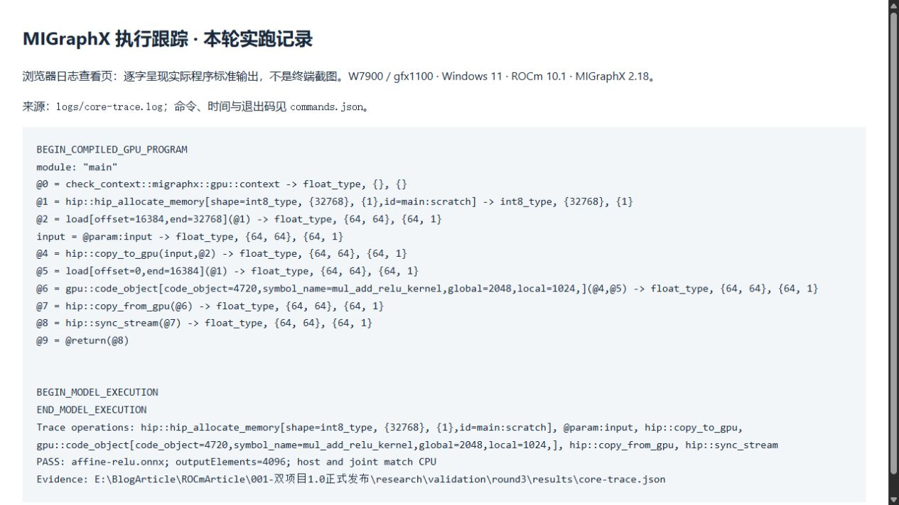
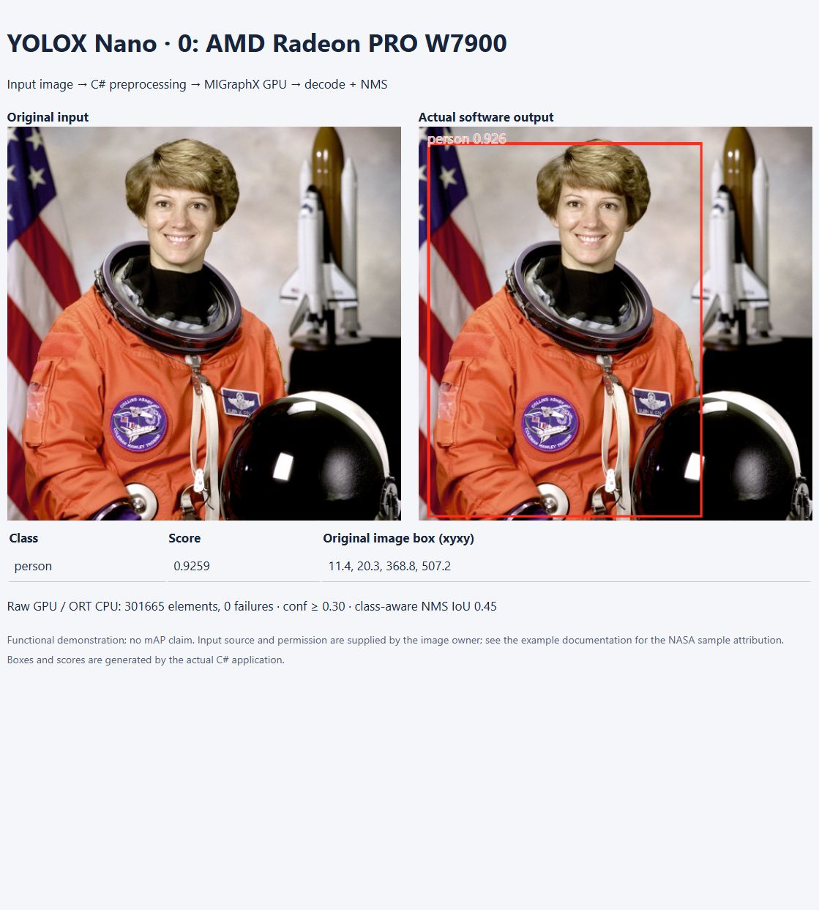
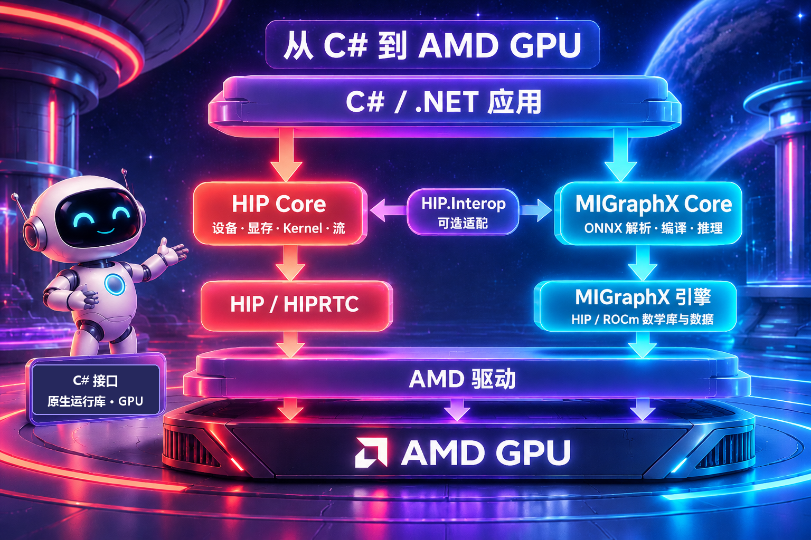
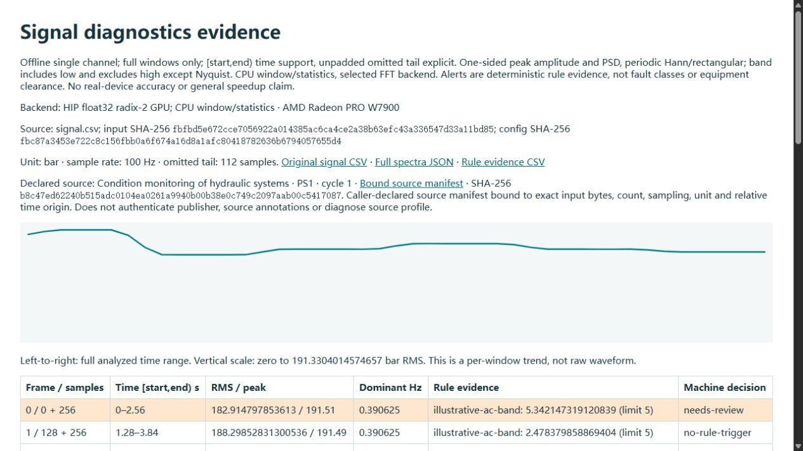
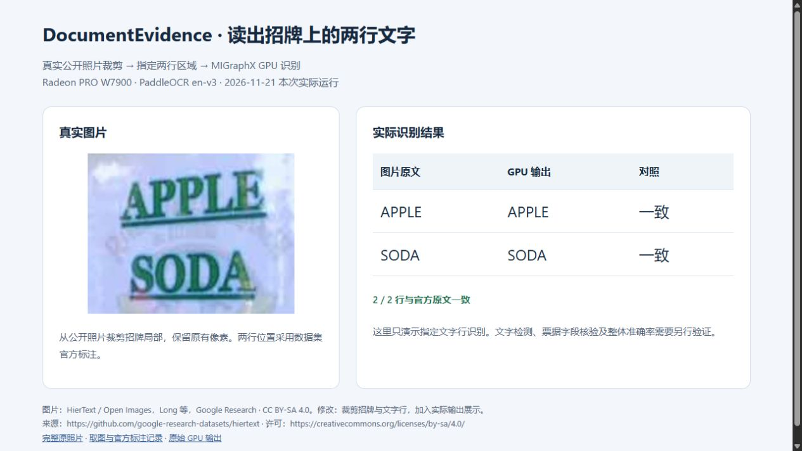

# C# 也能玩转 AMD GPU：从自定义计算到 AI 推理，让你的项目也加速起来

**用熟悉的 C#/.NET，调用 AMD GPU 做自定义计算、ONNX 推理和模型前后处理。**


*AIGC 概念封面，非实测截图。下文另附真实照片的 GPU 检测结果。*

之前和大家分享过 OpenVINO、TensorRT 的 C# 接口，这次把 AMD GPU 的入口也整理出来了。接入现有 .NET 工程，除了模型推理，还要处理原生依赖、设备缓冲区和业务流程。**HIP CSharp API 和 MIGraphX CSharp API 的 1.0.0 正式版已经发布**，配套平台 Runtime 和 HIP 适配包也已上架 NuGet。

如果你正在用AMD显卡设备使用 C#/.NET 开发工业视觉、桌面 AI 或数据处理应用，想自己写 GPU Kernel，或者把 ONNX 模型接进现有工程，这篇就带大家从选包、检查环境开始，完成第一次运行和数值验证，再看看怎样组合成应用。

## 一、让你的 C# 项目用上 AMD GPU

接入这两个项目后，C# 应用可以用 AMD GPU 完成三类工作。

**把批量计算交给 GPU。** 图像像素、信号采样和数组中经常有大量相同的计算。通过 HIP，可以编写自己的并行算法，再由 C# 上传数据、调用 GPU 计算并取回结果，把这部分能力接进现有业务代码。

**把 AI 模型接进 C# 应用。** 已有 ONNX 模型，可以通过 MIGraphX 在 C# 中完成加载、编译和推理，再把输出交给自己的界面或业务流程。项目里的目标检测、文字识别、图文匹配等示例，也提供了可以继续修改的工程起点。

**把模型前后处理一起串起来。** HIP 负责数据布局和数值处理，MIGraphX 负责模型推理，推理结果再交给 HIP 继续处理。这样可以把前处理、推理和后处理组织成一条 GPU 流程，中间数据继续留在设备上处理，由 C# 统一管理调用和资源。

从一个计算步骤开始，到接入一个模型，再到组织完整处理流程，都可以继续放在熟悉的 .NET 工程里完成。

## 二、为什么选择 HIP + MIGraphX？

两个项目各有分工：**HIP 组织自己写的 GPU 计算，MIGraphX 编译和运行已有模型，HIP.Interop 负责需要时把两者接起来。**

| 你现在的需求 | 先选哪个 | 可以从哪里开始 |
| --- | --- | --- |
| 图像处理、数值计算或自定义并行算法 | HIP CSharp API | 设备、显存、HIPRTC、Module、Kernel、Stream/Event |
| 已有 ONNX，想在 .NET 中做推理 | MIGraphX CSharp API | 模型解析、计算图编译、张量输入输出、程序复用 |
| 前处理、模型、后处理一起组织 | 两个 Core + HIP.Interop | 同一 Stream、具名设备输入、设备输出与资源生命周期 |

HIP Kernel 使用 HIP C/C++ 编写，C# 负责调用和资源管理。我保留了托管对象和低层 API 两条入口：常见任务可以用 `IDisposable` 管理设备资源，需要深入原生能力时，再往下使用对应接口。HIPRTC 用于在运行时把 Kernel 源码编译成设备代码。

MIGraphX 提供 ONNX 解析、编译、执行，以及动态形状、程序保存/加载和模型缓存等接口。仓库还有 YOLO26、PaddleOCR v4/v5/v6、CLIP、PP-Structure 示例，可以继续看检测、OCR、图文匹配和版面处理。

```text
YOLO26、PaddleOCR v4/v5/v6、CLIP、PP-Structure 示例
https://github.com/guojin-yan/MIGraphX-CSharp-API/tree/v1.0.0/samples
```

两个 Core 可以独立使用。只有需要连接 HIP Stream 和设备缓冲区时，才加入适配器；刚开始不必把全部包都装上。

## 三、HIP 与 MIGraphX：1.0.0 正式发布

这次带来两个开源项目：**HIP CSharp API 做自定义 GPU 计算，MIGraphX CSharp API 做 AI 模型推理。** 两者都能通过 NuGet 接入现有 C# 工程。

### HIP CSharp API：从 C# 调用自己的 GPU 算法

AMD HIP Runtime 与 HIPRTC 的 C#/.NET 接口库，提供托管对象和低层 API 两种入口。

- **自己写 GPU 算法**：用 HIP C/C++ 编写 Kernel，由 C# 调用，接入图像、信号和数值处理。
- **运行时编译**：通过 HIPRTC 编译 Kernel，也能直接加载预编译的设备模块。
- **显存与数据传输**：设备选择、显存分配、数据上传下载，都有对应接口。
- **异步执行与计时**：通过 Stream/Event 安排计算任务、同步结果、测量执行时间。
- **熟悉的资源管理**：使用 `using` / `Dispose` 管理资源，异步在途资源有保活机制。
- **现成教程与示例**：中英文 API 注释，配有设备枚举、内存拷贝、VectorAdd 等可运行示例。

### MIGraphX CSharp API：把 ONNX 模型接进 .NET 应用

AMD MIGraphX 的 C#/.NET 接口库，覆盖模型加载、张量管理、GPU 编译与推理。

- **ONNX 模型直接接入**：从文件或内存加载模型，在 C# 中完成 GPU 编译和执行。
- **灵活的输入输出**：支持多输入输出、类型化张量和动态输入形状，结果可读取为 C# 数组。
- **模型图与程序复用**：同一进程内复用已编译程序；另有保存、加载和显式缓存接口，跨进程行为见第六节实测。
- **前处理、推理、后处理串联**：通过 HIP.Interop，在同一 HIP Stream 上连接设备缓冲区与计算任务。
- **四类工程示例**：YOLO26 检测与分割、PaddleOCR 文字识别、CLIP 图文匹配、PP-Structure 文档结构分析。

两个 Core 可独立引用，联合流程再加入 HIP.Interop。**七个 NuGet 包已发布**，按用途选择即可：

| NuGet 包 | 版本 | 职责 | 地址（可复制） |
| --- | --- | --- | --- |
| `JYPPX.ROCm.HIP.CSharp.API` | 1.0.0 | HIP 托管接口，Core 不包含显卡驱动 | `https://www.nuget.org/packages/JYPPX.ROCm.HIP.CSharp.API/1.0.0` |
| `JYPPX.ROCm.HIP.CSharp.API.Runtime.win-x64` | 10.1.0 | Windows HIP/HIPRTC 用户态运行库 | `https://www.nuget.org/packages/JYPPX.ROCm.HIP.CSharp.API.Runtime.win-x64/10.1.0` |
| `JYPPX.ROCm.HIP.CSharp.API.Runtime.ubuntu.24.04-x64` | 10.1.0 | Ubuntu 24.04 HIP/HIPRTC 用户态运行库 | `https://www.nuget.org/packages/JYPPX.ROCm.HIP.CSharp.API.Runtime.ubuntu.24.04-x64/10.1.0` |
| `JYPPX.ROCm.MIGraphX.CSharp.API` | 1.0.0 | ONNX 与 MIGraphX 托管接口 | `https://www.nuget.org/packages/JYPPX.ROCm.MIGraphX.CSharp.API/1.0.0` |
| `JYPPX.ROCm.MIGraphX.CSharp.API.HIP.Interop` | 1.0.0 | HIP Stream 和设备输入输出适配 | `https://www.nuget.org/packages/JYPPX.ROCm.MIGraphX.CSharp.API.HIP.Interop/1.0.0` |
| `JYPPX.ROCm.MIGraphX.CSharp.API.Runtime.win-x64` | 1.0.0 | Windows MIGraphX 2.18.0 引擎 | `https://www.nuget.org/packages/JYPPX.ROCm.MIGraphX.CSharp.API.Runtime.win-x64/1.0.0` |
| `JYPPX.ROCm.MIGraphX.CSharp.API.Runtime.ubuntu.24.04-x64` | 1.0.0 | Ubuntu MIGraphX 2.18.0 引擎 | `https://www.nuget.org/packages/JYPPX.ROCm.MIGraphX.CSharp.API.Runtime.ubuntu.24.04-x64/1.0.0` |

注意区分三个版本：C# Core/适配器是 `1.0.0`，HIP Runtime 包是 `10.1.0`，MIGraphX Runtime 包是 `1.0.0`、内部引擎是 `2.18.0`。升级联合工程时，两个 Core 和适配器一起核对，避免输出目录残留旧原生库。

**Windows MIGraphX 引擎是我在本地基于 AMD 源码、加入 Windows 适配补丁构建的版本**，随项目 Runtime 分发，设备代码针对 gfx1100。Ubuntu 引擎采用 AMD 二进制并调整 ELF 加载路径。包内 `native-manifest.json` 保留源码身份、版本、文件哈希和主机依赖，`licenses/` 保留第三方许可。

MIGraphX 引擎包需要配合 **ROCm 10.1 的 HIP/HIPRTC、COMGR、MIOpen、rocBLAS、hipBLASLt、GPU 设备数据和 bitcode**；显卡驱动另装，Windows 还需要 VC++ x64 运行库。此处NuGet 不安装完整 ROCm，也不替换驱动。同一进程内保持同一套原生库家族。

安装前先看 MIGraphX 部署指南和 HIP Runtime 来源与分发说明。AMD 维护上游 HIP/MIGraphX，我主要维护 C# 封装和本项目分发工作；本项目的发布与测试不能理解为 AMD 官方认证。

```text
MIGraphX 部署指南
https://github.com/guojin-yan/MIGraphX-CSharp-API/blob/v1.0.0/docs/guides/runtime-deployment.md

HIP Runtime 来源与分发说明
https://github.com/guojin-yan/HIP-CSharp-API/blob/b18bb40ef9b85a4c09747ea8b42e2382d261f0e3/docs/guides/runtime-distribution-10.1.0.md
```

## 四、从零运行，再验证计算结果

本文命令的实际 GPU 基线是 **Radeon PRO W7900 / gfx1100、Windows 11、ROCm 10.1、MIGraphX 2.18**。

### 先检查环境，按用途安装

本文工程目标为 .NET 10。安装好系统依赖后，先确认 SDK 和设备：

```powershell
dotnet --list-sdks
Get-CimInstance Win32_VideoController | Select-Object Name, DriverVersion
```

从空目录创建工程时，按下面三条路径选包。Windows 是本文实跑路径；Ubuntu 使用表中的对应 Runtime、`linux-x64` RID，并按 Linux 部署指南配置驱动和库。

| 路径 | 最少引用 | 下一步 |
| --- | --- | --- |
| HIP Kernel | HIP Core 1.0.0 + win Runtime 10.1.0，或兼容系统 HIP | HipHello、VectorAdd |
| ONNX 推理 | MIGraphX Core 1.0.0 + win 引擎包 1.0.0 + ROCm 系统依赖 | Identity、非平凡 ONNX |
| 联合流程 | 上述两个 Core + HIP.Interop 1.0.0，同一套原生环境 | Stream、设备 I/O、HIP 前后处理 |

例如先建一个 ONNX 工程：

```powershell
dotnet new console -n MyOnnx -f net10.0
cd MyOnnx
dotnet add package JYPPX.ROCm.MIGraphX.CSharp.API --version 1.0.0
dotnet add package JYPPX.ROCm.MIGraphX.CSharp.API.Runtime.win-x64 --version 1.0.0
# 需要联合处理时再加：
dotnet add package JYPPX.ROCm.HIP.CSharp.API --version 1.0.0
dotnet add package JYPPX.ROCm.MIGraphX.CSharp.API.HIP.Interop --version 1.0.0
```

想先看完整运行结果，可以直接运行随文示例。安装好 .NET SDK、兼容驱动、VC++ x64 运行库和 ROCm 10.1 系统依赖后，在准备存放源码的目录另开一个 **PowerShell 7** 终端：

```powershell
git clone https://github.com/guojin-yan/BlogArticle.git
Set-Location './BlogArticle'
$articleDir = (Resolve-Path './ROCmArticle/001-双项目1.0正式发布').Path
pwsh -File "$articleDir/examples/run-windows.ps1" -CheckOnly
pwsh -File "$articleDir/examples/run-windows.ps1" -Architecture gfx1100
```

已有仓库副本时，直接进入其根目录，从 `$articleDir` 那行开始即可；仓库可以放在任意盘符和目录。脚本优先读取 `HIP_PATH`，未配置时会提示输入你自己的 ROCm 10.1 HIP 安装目录（包含 `bin`、`lib`）。也可用 `-HipRoot` 显式指定。

`-CheckOnly` 会报告 `PASS / FAIL / SKIP / NOT CHECKED`，检查 HIP 设备、HIPRTC 编译、MIGraphX 对象、原生文件和模型，并记录实际加载路径。**预检通过仍要运行示例**：它没有覆盖每个数学库算子。失败先看 JSON 的排错建议和下方故障表；脚本不修改全局 PATH、不安装驱动或依赖。

包装脚本只为当前进程配置 ROCm 路径，然后依次检查下面四项；首次运行包括 NuGet 还原，驱动和 SDK 安装时间需另外预留。`gfx1100` 是本文设备架构，其他设备先核对对应支持范围。

### 从设备到 HIP Kernel

HipHello 会打印 Runtime、Driver 和设备名。我本机是：

```text
HipHello
https://github.com/guojin-yan/BlogArticle/blob/main/ROCmArticle/001-双项目1.0正式发布/examples/HipHello/Program.cs
```

```text
HIP Runtime: 7.16.26385
HIP Driver:  7.16.26385
0: AMD Radeon PRO W7900
```

原生库报告的版本号与 NuGet 分发版本分开解释。枚举设备后，VectorAdd 会执行 `c[i] = a[i] + b[i]`：上传固定输入、编译 Kernel、启动、同步、下载，再与 CPU 逐元素比较。每轮输出预填 NaN，尾部元素和漏写结果也会检查。

```text
VectorAdd
https://github.com/guojin-yan/BlogArticle/blob/main/ROCmArticle/001-双项目1.0正式发布/examples/HipVectorAdd/Program.cs
```

```text
Kernel: VectorAdd; arch=gfx1100; blocks=257; threads=256
PASS: length=65539; repetitions=3; max_abs_error=0; atol=1E-06
```

这是实际执行结果，原始日志还保留生成代码的哈希。架构参数按实际 GPU 填写。

```text
原始日志
https://github.com/guojin-yan/BlogArticle/blob/main/ROCmArticle/001-双项目1.0正式发布/research/validation/issue1-vectoradd-run.log
```

### ONNX：先跑通 API，再检查真正的计算

Identity 示例的输入是 `float32[1,4]`、参数名 `input`，输出为：

```text
Identity 示例
https://github.com/guojin-yan/BlogArticle/blob/main/ROCmArticle/001-双项目1.0正式发布/examples/MigraphxHello/Program.cs
```

```text
1, 2, 3, 4
```

它是 **Loader/API/模型执行链路的 Smoke Test**。Identity 图可能被优化，正确输出和 `target="gpu"` 都不能单独证明 GPU Kernel 做了非平凡计算，更不能证明性能提升。

接着运行 MigraphxCompute。随文模型是固定 `float32[64,64]`，公式为 `max(0, x × 0.5 + 0.25)`，由标准库生成器生成；输入也由固定公式生成。它比较独立 C# 公式、ONNX Runtime CPU、MIGraphX 主机 I/O 和 HIP 联合路径的全部 4,096 个输出，容差预先固定为 `0.001 + 0.001 × abs(CPU参考)`，本轮最大绝对误差均为 0。

```text
MigraphxCompute
https://github.com/guojin-yan/BlogArticle/blob/main/ROCmArticle/001-双项目1.0正式发布/examples/MigraphxCompute/Program.cs

标准库生成器
https://github.com/guojin-yan/BlogArticle/blob/main/ROCmArticle/001-双项目1.0正式发布/examples/MigraphxCompute/generate-model.py
```

想看实际执行记录，在上面的终端继续执行：

```powershell
pwsh -File "$articleDir/examples/run-windows.ps1" -Mode trace
```

本轮编译图与执行跟踪出现了以下 GPU 指令：

```text
gpu::code_object[symbol_name=mul_add_relu_kernel,global=2048,local=1024,...]
hip::copy_from_gpu
hip::sync_stream
PASS: affine-relu.onnx; outputElements=4096; host and joint match CPU
```



*实际浏览器截图，逐字显示程序日志；不是终端或独立 Profiler 截图。设备枚举与 VectorAdd 的原始日志截图见本轮配套资料。*

这里有三组相互配合的证据：实际执行跟踪、仅使用设备输入的同步运行与 CPU 数值对照，以及包围模型和 D2D 复制的 HIP event 完成区间，见结果 JSON。RunTrace 是执行元数据，event 区间包含复制与排队，二者均不提供独立的逐 Kernel Profiler 时间线。这些记录用于核验该固定计算的 GPU 路径；性能另外测量。

```text
实际执行跟踪
https://github.com/guojin-yan/BlogArticle/blob/main/ROCmArticle/001-双项目1.0正式发布/research/validation/issue1-affine-trace.log

结果 JSON
https://github.com/guojin-yan/BlogArticle/blob/main/ROCmArticle/001-双项目1.0正式发布/research/validation/issue1-affine-result.json
```

### 用一张真实照片完成目标检测

张量校验后，再跑一个完整业务流程：**图片解码 → 缩放补边/BGR/CHW → MIGraphX → YOLOX 解码 → NMS → 原图坐标与结果导出**。示例使用 scikit-image 收录的 NASA 宇航员照片，来源说明为公有领域；换自己的图片时沿用同一流程。

```powershell
$photoRoot = "$articleDir/.validation/photo"
New-Item -ItemType Directory -Force -Path "$photoRoot/inputs", "$photoRoot/results" | Out-Null
Invoke-WebRequest 'https://raw.githubusercontent.com/scikit-image/scikit-image/v0.19.3/skimage/data/astronaut.png' -OutFile "$photoRoot/inputs/astronaut.png"
Invoke-WebRequest 'https://github.com/Megvii-BaseDetection/YOLOX/releases/download/0.1.1rc0/yolox_nano.onnx' -OutFile "$photoRoot/inputs/yolox_nano.onnx"
# 模型与图片 SHA256 的核验命令见示例说明。
pwsh -File "$articleDir/examples/run-windows.ps1" -Mode detect -ModelPath "$photoRoot/inputs/yolox_nano.onnx" -ImagePath "$photoRoot/inputs/astronaut.png" -OutputPath "$photoRoot/results/photo.json"
```

第二轮 W7900 实跑得到 **1 个 person，分数 0.9259**，原始 301,665 个输出与 CPU 对照无超差。结果目录包含带框 PNG、类别/分数/坐标 JSON 和 `detection-report.html`，打开报告即可核对。人工查看后，框对应照片中的人物；这只是功能演示，没有独立标注，不报告 mAP 或业务准确率。


*NASA / Eileen Collins，via scikit-image，公有领域。红框由实际 C# 程序根据 GPU 输出绘制；这是结果图。原图、hash、源码与完整日志见第二轮验证资料。*



*实际报告的浏览器视口截图，显示 W7900、检测框与 CPU 数值对照；对应上一轮真实推理结果，本轮未重跑该照片。*

### 第一次运行失败，先查哪里？

| 现象 | 先检查什么 |
| --- | --- |
| 缺少 `amdhip64` / `hiprtc` | x64 进程、平台 Runtime、原生文件是否复制、SDK/PATH 与 HIP 加载诊断 |
| MIGraphX `ProbeSystem()` 失败 | `Diagnostics`、`LoadedPath`、RID 目录、GPU 插件及其依赖 |
| rocBLAS / hipBLASLt 初始化失败 | ROCm 家族、Tensile/gfx 目录；Windows 设备库路径使用反斜杠，随文脚本已统一处理 |
| HIPRTC 或 module 加载失败 | 实际 GPU 架构、`--arch`、完整编译日志与错误码 |
| 插件存在但不能加载 | 传递依赖；Ubuntu 还要核对符号链接和 helper 权限 |

具体环境变量、Ubuntu 包替换、模型哈希及手动运行命令，见上手与验证和示例说明。

```text
上手与验证
https://github.com/guojin-yan/BlogArticle/blob/main/ROCmArticle/001-双项目1.0正式发布/05-上手与验证.md

示例说明
https://github.com/guojin-yan/BlogArticle/blob/main/ROCmArticle/001-双项目1.0正式发布/examples/README.md
```

## 五、从模型走向业务流水线

把模型跑通后，还可以继续把前后处理接进 GPU：HIP 做布局变换和数值处理，MIGraphX 运行模型，HIP 再做筛选，最后取回业务需要的结果。



*AIGC 架构示意图，非实测截图。两个 Core 独立使用；需要 HIP Stream 和设备缓冲区时，再加入 HIP.Interop。*

本文联合示例实际做了 **主机 HWC float 输入 → H2D → HIP 转 CHW → MIGraphX → D2D 输出复制 → HIP clamp → D2H → 同步**。`RunDeviceIntoAsync` 会复制输出到调用者缓冲区，不能把它称为零拷贝。只要最后仍需完整输出，下载成本就仍在；收益要结合传输、同步、Kernel 启动、缓冲区复用和托管调用开销一起看。

我还做了四个持续完善的应用参考，展示这些接口在业务中的用法。原有四张图保留为 **AIGC 流程示意图，非实测截图**；另附四个应用本轮使用公开真实数据运行后的工作台与报告截图。源码、数据来源和许可见各案例地址。

### SurfaceLab：工业图像检测与复核


把图像批次、规则检测与实验异常模型、热图展示和人工复核串在一起，提供质检工具的开发参考，并支持导出复核报告。


*VisA pcb1 的 12 张真实图像（CC BY 4.0），本轮由 DINOv2/PatchCore 经 MIGraphX GPU 处理，全部待人工复核。固定阈值下，6 张正常图判为合格，6 张异常图检出 3 张、漏检 3 张；完整结果保留，不作为生产精度证明。*

```text
https://github.com/guojin-yan/ROCm-CSharp-Projects/tree/2f70b96267484b441fa726a3d496b8cc55d47219/projects/IndustrialInspection

真实数据：Amazon Science VisA（Yang Zou 等），CC BY 4.0
https://github.com/amazon-science/spot-diff
```

### SignalDiagnostics：从离线信号到分析报告


以这个案例为例，可以看看一项 GPU 计算怎样接进完整应用：

- **输入**：UCI 液压系统数据集的 PS1 压力信号，第 1 个 60 秒周期，100 Hz、6,000 个原始采样值，单位 bar。
- **处理**：用 HIP FFT 分析频率成分，按规则找出待复核的时间段。
- **输出**：频谱、窗口 RMS 趋势和 HTML 报告，支持回看原始样本、记录人工复核结果。

做采样数据分析或离线检测工具的朋友，可以从这里参考数据导入、GPU 计算和报告展示的组织方式。



*真实压力数据未缩放或重采样。45 个窗口、5,805 个 PSD 值通过 CPU/HIP 对照，1 个窗口触发示例规则；尾部 112 点未分析。曲线为窗口 RMS 趋势，规则阈值不代表设备故障标准。*

```text
https://github.com/guojin-yan/ROCm-CSharp-Projects/tree/2f70b96267484b441fa726a3d496b8cc55d47219/projects/SignalDiagnostics

真实数据：Helwig、Pignanelli、Schütze，UCI 447，CC BY 4.0
https://archive.ics.uci.edu/dataset/447/condition+monitoring+of+hydraulic+systems
```

### DocumentEvidence：OCR 与文档核验


将已有 OCR 结果或指定文字行识别，与字段、金额核验和人工修正记录结合，输出便于查阅的文档报告。



*从 HierText / Open Images 真实照片中裁出白底招牌（CC BY-SA 4.0），指定两行文字区域后，GPU 实际读出 `APPLE`、`SODA`，均与官方原文一致。这里只展示行识别流程。*

```text
https://github.com/guojin-yan/ROCm-CSharp-Projects/tree/2f70b96267484b441fa726a3d496b8cc55d47219/projects/DocumentEvidence

真实数据：Long 等，Google Research HierText / Open Images，CC BY-SA 4.0
https://github.com/google-research-datasets/hiertext
```

### VideoEventSearch：按候选事件回看视频


对离线视频整理区域进入、越线、停留等候选事件，并关联原始帧和时间点，方便按事件定位、回看和复核。


*NASA Demo-2 Walkout 真实公开视频，预先固定约 30–40 秒的连续区间。25 个抽帧经 MIGraphX GPU 产生 109 条检测、12 个待复核候选事件；框由程序真实输出绘制，未手工补画。没有独立事件标注，素材仅作技术分析，不代表 NASA 认可项目。*

```text
https://github.com/guojin-yan/ROCm-CSharp-Projects/tree/2f70b96267484b441fa726a3d496b8cc55d47219/projects/VideoEventSearch

真实素材：NASA Image and Video Library，按 NASA 媒体使用指南引用
https://images.nasa.gov/details/KSC-20200530-MH-AJW02-0003-SpaceX_Demo-2_Walkout_Hallway_and_C7_Exit_4K
https://www.nasa.gov/nasa-brand-center/images-and-media/
```

## 六、验证结果与使用边界

### 平台验证

正式组合以 **W7900 / gfx1100、ROCm 10.1、MIGraphX 2.18** 为主要 GPU 验证基线，包版本见第三节。

| 平台 | HIP 发布检查 | MIGraphX 发布检查 |
| --- | --- | --- |
| Windows x64 | 23 项通过，1 项能力跳过（managed memory） | 25 项 GPU 组合检查通过 |
| Ubuntu 24.04 / WSL2 | 21 项通过，2 项能力跳过（managed memory、arrays） | 7 组 / 30 项通过 |
| 原生 Linux / KFD | 当前正式组合未独立验证 | 当前正式组合未独立验证 |

2026-11-19 的新增验证运行在 **Windows 11 / .NET 10**，设备枚举、VectorAdd、Identity、Affine/ReLU、YOLOX Nano 与信号数值检查均通过。WSL2 结果不外推为原生 Linux 验证；其他 GPU 仍需实测，多目标框架构建也不等于所有系统组合都已认证。

### 五轮实际模型测量

我用 **Ryzen 9 5900XT + W7900** 对 YOLOX Nano ONNX 做了五组对照：CPU 使用 ONNX Runtime 1.23.2，GPU 环境同上。输入统一为固定合成 RGB，float32、batch=1、`1×3×416×416`，输出统一做 clamp。

| 路径 | 五轮 P50 中位数，ms | 各轮 P50 范围，ms |
| --- | --- | --- |
| ONNX Runtime CPU | 14.773 | 14.424–15.022 |
| MIGraphX，逐次创建 Host 参数 | 20.565 | 19.836–21.478 |
| Host 参数复用（仅固定输入重放） | 19.249 | 17.746–19.452 |
| Device I/O，CPU 前后处理 | 7.232 | 6.853–7.386 |
| HIP + MIGraphX，设备前后处理 | 5.228 | 5.053–5.397 |

2026-11-20 用 **5 个独立进程**复测，每轮每路径预热 10 次、测量 30 次，路径顺序逐次随机化；全部样本和 P95 保留。端到端范围为**已解码主机 HWC float → 主机端后处理输出**，包括传输、布局、同步、clamp，排除解码、NMS、模型编译和可复用缓冲区分配，**不是完整图片检测耗时**。合成输入不评估检测精度；四条 GPU 对照的最终输出，以及原始模型输出的 Host/联合对照，均无超差或非有限值。

当前 Host API 不能原地更新已创建参数，因此固定输入复用行不能代表连续新图片。Device I/O 对照保留必要传输、由 CPU 做前后处理；完整联合路径再换成 HIP Kernel。结果反映整条实现的成本，**不能把全部差值归因于 GPU 算子速度或零拷贝**。旧两轮记录仍保留，本轮不择取最快一轮。

**启动成本也要算进去。** 五轮中位数：CPU Session 创建约 **0.100 秒**，Host 图编译约 **25.13 秒**，Device 图编译约 **19.41 秒**，HIP 编译约 **63 ms**。进程内首次调用约为 CPU **26.8–161.3 ms**、Host GPU **38.1–44.2 ms**、联合 GPU **20.3–21.5 ms**；随后才是上表热态耗时。长驻应用可以复用程序，低频调用需同时考虑启动时间；未清驱动/磁盘缓存，`cache-cold NOT TESTED`。

### 接入前留意三点

- **环境与模型兼容**：本轮定位并修正 Windows hipBLASLt 设备库路径分隔符问题，MatMul、PCB 模型和 OCR 已重新通过编译。随文脚本统一生成 Windows 路径；小 INT8 问题沿用发布记录、本轮未复跑，Windows 引擎不含 TensorFlow importer。
- **测量范围**：本轮没有独立 Kernel Profiler、干净冷启动或单进程峰值显存数据，也未锁 GPU 时钟和功耗。
- **应用成熟度**：第三轮 264 项自动测试通过；本轮完成四案例真实数据复跑，保留全部漏检、错字和待复核事件。视频编译仍有 MIOpen/rocBLAS 候选错误日志；业务精度和生产验收需另验。

另外，未编译图在新进程中的缓存命中已通过，但命中后仍需约 **27–32 秒**编译；中文缓存路径保存、已编译 YOLOX 图的载入后重编译均失败，不能承诺命中即可免编译。完整结果、相对误差的近零值解释、预检范围与失败日志集中在配套资料：

```text
上手与验证
https://github.com/guojin-yan/BlogArticle/blob/main/ROCmArticle/001-双项目1.0正式发布/05-上手与验证.md

第二轮复测与修订说明
https://github.com/guojin-yan/BlogArticle/blob/main/ROCmArticle/001-双项目1.0正式发布/research/issue-2-修订说明.md

四个案例的真实数据、运行结果与截图
https://github.com/guojin-yan/BlogArticle/blob/main/ROCmArticle/001-双项目1.0正式发布/research/真实开源数据案例与截图.md
```

## 七、下一步：接入你自己的项目

按需求选一条路线，先跑通示例，再换成自己的计算或模型：

- **先跑 VectorAdd**：应看到 `max_abs_error=0`，再替换自己的 Kernel。[源码入口](https://github.com/guojin-yan/BlogArticle/blob/main/ROCmArticle/001-双项目1.0正式发布/examples/HipVectorAdd/Program.cs)。
- **再跑 ONNX 数值对照**：Identity 输出 `1, 2, 3, 4`，Affine/ReLU 显示 4,096 元素通过。[运行说明](https://github.com/guojin-yan/BlogArticle/blob/main/ROCmArticle/001-双项目1.0正式发布/examples/MigraphxCompute/README.md)。
- **最后换自己的图片或业务数据**：沿用真实照片流程，检查框、分数和 CPU/GPU 输出，再测完整业务耗时。[完整示例](https://github.com/guojin-yan/BlogArticle/blob/main/ROCmArticle/001-双项目1.0正式发布/examples/README.md)。

以上三个入口也提供可复制地址，环境配置和命令见第四节：

```text
VectorAdd
https://github.com/guojin-yan/BlogArticle/blob/main/ROCmArticle/001-双项目1.0正式发布/examples/HipVectorAdd/Program.cs

ONNX 数值对照
https://github.com/guojin-yan/BlogArticle/blob/main/ROCmArticle/001-双项目1.0正式发布/examples/MigraphxCompute/README.md

真实图片与完整示例
https://github.com/guojin-yan/BlogArticle/blob/main/ROCmArticle/001-双项目1.0正式发布/examples/README.md
```

欢迎试用、Star，也欢迎提 Issue、补充设备验证或模型示例。反馈请附**环境版本、原生库加载路径、最小复现与输入、预期/实际结果和日志**，完整模板见配套说明。

```text
HIP
https://github.com/guojin-yan/HIP-CSharp-API

MIGraphX
https://github.com/guojin-yan/MIGraphX-CSharp-API

ROCm C# 应用集合
https://github.com/guojin-yan/ROCm-CSharp-Projects

文章反馈
https://github.com/guojin-yan/BlogArticle/issues
```

项目源码采用 Apache-2.0；原生组件、模型、数据、文章和配图按各自授权使用，分发时保留相应许可与来源通知。

Copyright © 2026 Guojin Yan / 椒颜皮皮虾。
