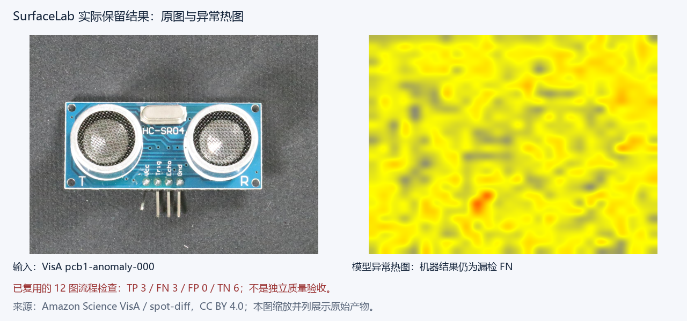
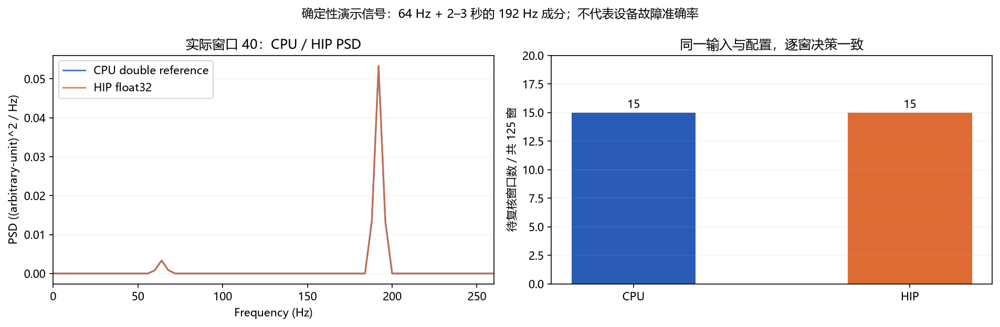
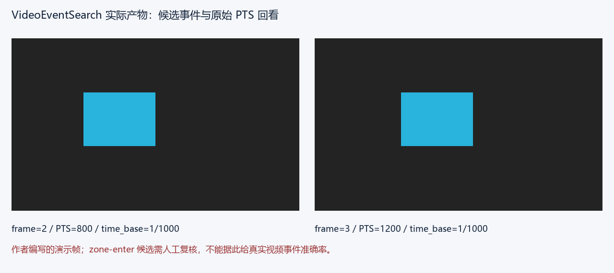

# HIP + MIGraphX 1.0：上手路径、验证记录与排错

这是[第 001 篇发布文章](03-正文.md)的配套说明，最新核对日期为 **2026-11-21（Asia/Shanghai）**。正文 v12 保留七章并精简重复文字；本轮仅复核既有终端图来源，没有新增 GPU 运行，见[第九轮记录](research/validation/round9/README.md)。这里集中放运行条件、可复制命令和验证依据。第八轮已将核心展示换为真实 PowerShell 终端截图；第七轮保留硬件/依赖预检、新检出与空 NuGet 缓存实跑。四案例和简单 OCR 分别见[第五轮](research/validation/round5/README.md)、[第六轮](research/validation/round6/README.md)。当前逐项状态见[Issue #2 验收对照](research/issue-2-当前验收对照.md)。下方各轮记录按执行日期保留，不把历史 PASS 当成本次复验。

下文源码路径均相对于读者下载的仓库，安装目录取自你自己的环境。原始日志和 JSON 中的绝对路径仅记录测试机器的实际加载位置，无需照搬。

## 一、先选路线和版本

| 你的目标 | 托管包 | 原生环境 | 第一步 |
| --- | --- | --- | --- |
| 自定义 GPU Kernel | HIP Core `1.0.0` | 对应平台 HIP Runtime `10.1.0`，或兼容系统 HIP | HipHello → HipVectorAdd |
| ONNX 推理 | MIGraphX Core `1.0.0` | 对应平台 MIGraphX Runtime `1.0.0`，内含引擎 `2.18.0`；另装 ROCm `10.1` 系统依赖 | MigraphxHello → 完整模型示例 |
| HIP 前后处理 + 模型推理 | 两个 Core `1.0.0` + HIP.Interop `1.0.0` | 同一套 ROCm `10.1` / MIGraphX `2.18` 原生库 | 先分别跑通，再接 HIP Stream 和设备缓冲区 |

HIP Runtime 的 `10.1.0`、MIGraphX Runtime 的包版本 `1.0.0`、内部引擎版本 `2.18.0` 分别标识不同组件。HIP Core 不强制携带 Runtime；MIGraphX Core 和适配器也只有托管程序集。系统中已有兼容原生安装时，可以按指南显式选择它。

Windows MIGraphX 引擎是项目基于 AMD `rocm-10.1` 源码并包含 Windows 补丁构建的版本，设备代码针对 `gfx1100`。Ubuntu 引擎来自 AMD 二进制并调整 ELF 加载路径，GPU 验证使用 WSL2。它们是社区项目提供的分发组合，不能由此推导 AMD 对封装项目的官方认证。

## 二、Windows 环境预检

先准备 x64 .NET SDK、兼容的 AMD GPU 驱动、VC++ x64 运行库。本文示例目标为 .NET 10；生成 Identity 模型另需 Git 与 PowerShell 7。使用已随文提供的模型则无需重新生成。

```powershell
dotnet --list-sdks
Get-CimInstance Win32_VideoController | Select-Object Name, DriverVersion
```

MIGraphX 2.18 引擎还需要 ROCm 10.1 的 HIP/HIPRTC、COMGR、MIOpen、rocBLAS、hipBLASLt、传递依赖、GPU 设备数据和 bitcode。NuGet 引擎包不安装完整 SDK，也不安装驱动。在 PowerShell 7 中读取自己的 `HIP_PATH`，未配置时输入包含 `bin`、`lib` 的 ROCm 10.1 HIP 安装目录，再为当前终端设置：

```powershell
$rocmHipRoot = $env:HIP_PATH
if ([string]::IsNullOrWhiteSpace($rocmHipRoot)) {
    $rocmHipRoot = Read-Host '输入 ROCm 10.1 HIP 安装目录（包含 bin 和 lib）'
}
if ([string]::IsNullOrWhiteSpace($rocmHipRoot)) { throw '请提供 HIP 安装目录' }
$rocmHipRoot = (Resolve-Path -LiteralPath $rocmHipRoot).Path
if (!(Test-Path -LiteralPath "$rocmHipRoot/bin")) { throw '请先核对 ROCm 10.1 安装目录' }
$env:HIP_PATH = $rocmHipRoot
$env:ROCM_PATH = $rocmHipRoot
$env:PATH = "$rocmHipRoot/bin;$rocmHipRoot/lib/llvm/bin;$env:PATH"
$env:HIP_DEVICE_LIB_PATH = "$rocmHipRoot/lib/llvm/amdgcn/bitcode"
$env:ROCBLAS_TENSILE_LIBPATH = "$rocmHipRoot/bin/rocblas/library"
$env:HIPBLASLT_TENSILE_LIBPATH = "$rocmHipRoot/bin/hipblaslt/library/gfx1100"
```

最后一行是当前 `gfx1100` 基线的设备数据目录。不同 GPU 先核对项目构建范围、设备数据和 AMD 驱动要求。一次进程只加载同一套原生库，改变配置后重新启动进程，不混用 ROCm 7.2.1 与 10.1 的文件。

## 三、直接运行本文的四个示例

在准备存放源码的目录克隆文章仓库，再进入其根目录；已有副本时直接进入本地 `BlogArticle` 目录，跳过这两行：

```powershell
git clone https://github.com/guojin-yan/BlogArticle.git
Set-Location './BlogArticle'
```

仓库可放在任意目录。以下命令在同一终端、**BlogArticle 仓库根目录**执行，沿用第二节配置的环境。示例只引用正式 NuGet 包；首次运行需要可用的包源。下面手动运行前三项，第四项 MigraphxCompute 及四项统一包装命令见[示例说明](examples/README.md)。

```powershell
$articleDir = (Resolve-Path './ROCmArticle/001-双项目1.0正式发布').Path
dotnet run --project "$articleDir/examples/HipHello" -c Release
dotnet run --project "$articleDir/examples/HipVectorAdd" -c Release -- --arch gfx1100

# Identity 模型按当前目录读取，因此进入该示例目录运行。
Push-Location "$articleDir/examples/MigraphxHello"
try { dotnet run -c Release } finally { Pop-Location }
```

### HIP：从找到设备到执行 Kernel

HipHello 应打印 Runtime、Driver 和设备名称。它验证设备枚举，不执行向量计算。

[HipVectorAdd 源码](examples/HipVectorAdd/Program.cs)执行以下步骤：固定输入 → HIPRTC 编译 → 分配并上传设备内存 → `VectorAdd` Kernel → 显式同步 → 下载结果 → 与 CPU 逐元素比对。输入共 `65,539` 个 float32，线程块 `256`，网格 `257`，重复 `3` 轮；每轮把设备输出重置为 NaN，检查尾部元素和未写入结果。绝对误差容差固定为 `1e-6`，出现非有限值或超差返回非零退出码。

本轮 Windows 11 / W7900 / gfx1100 实际输出：

```text
Device: 0: AMD Radeon PRO W7900
HIP Runtime: 7.16.26385
Kernel: VectorAdd; arch=gfx1100; blocks=257; threads=256
PASS: length=65539; repetitions=3; max_abs_error=0; atol=1E-06
```

原始日志还记录生成代码的 SHA-256，见 [VectorAdd 运行日志](research/validation/issue1-vectoradd-run.log)。本轮记录了 HIP 编译、Kernel 提交、同步和设备结果的数值检查，**没有采集独立 Profiler trace，也没有做 CPU/GPU 性能对比**。这组结果用于证明该设备上的功能和数值路径，不是吞吐或加速倍数。

### MIGraphX：Identity 用于检查调用流程

[MigraphxHello 源码](examples/MigraphxHello/Program.cs)从内存解析随文的 `identity.onnx`，输入 `float32[1,4]`，参数名 `input`，输入值 `1, 2, 3, 4`。期望输出同样为 `1, 2, 3, 4`。它覆盖加载器、对象创建、ONNX 解析、编译、主机输入输出与释放。

Identity 是冒烟检查。图可能被优化，`target="gpu"` 和正确输出不能独立证明 GPU Kernel 承担了非平凡计算，也不能说明性能提升。上面的 HIP VectorAdd 是独立的计算检查，不替代 MIGraphX 模型的 Kernel 活动证据。

本轮进一步提供了 `examples/MigraphxCompute`：默认 Affine/ReLU 模型的输入为 float32[64,64]，执行 `max(0,x*0.5+0.25)`。4,096 个结果与独立 C# 公式及 ONNX Runtime CPU 逐项一致；MIGraphX 主机 I/O、HIP 设备前后处理路径也通过数值检查。运行方法见[示例说明](examples/README.md)。

实际 `RunTrace` 记录含 `mul_add_relu_kernel`、GPU 复制与同步，结果 JSON 还记录设备输入/输出和包围模型及 D2D 复制的 HIP event 区间。它们组成此固定任务的执行证据，但没有独立逐 Kernel Profiler 时间线，不能把元数据跟踪当作硬件计数器。原始记录见 [Affine 执行日志](research/validation/issue1-affine-trace.log)和[数值与设备结果](research/validation/issue1-affine-result.json)。

另保留 64×64 MatMul + ReLU 的固定模型；旧环境变量拼接导致 hipBLASLt 设备库路径含正斜杠，在本机原生编译时触发访问冲突。[旧失败日志](research/validation/issue1-matmul-verify.log)不变；第五轮使用修正后的包装脚本，SDK 根目录输入正、反斜杠均完成 4,096 元素 CPU/Host GPU/联合 GPU 对照，maxAbs 均为 0。默认快速开始仍采用 Affine/ReLU。

### 联合路线：先接接口，再测整条流程

在模型工程目录补充：

```powershell
dotnet add package JYPPX.ROCm.HIP.CSharp.API --version 1.0.0
dotnet add package JYPPX.ROCm.MIGraphX.CSharp.API.HIP.Interop --version 1.0.0
```

参考 MIGraphX `v1.0.0/samples` 中的 HIP 互操作示例。先核对设备输入的尺寸、类型、容量与所有权，再接同一 Stream，并等待在途工作完成后释放资源。`RunDeviceAsync` 获取主机输出快照；`RunDeviceIntoAsync` 在同一 Stream 上向调用者缓冲区做 D2D 复制。不要把这条接口路径理解为所有任务都零拷贝、自动重叠或必然更快。

Ubuntu 24.04 使用的包名分别为 `JYPPX.ROCm.HIP.CSharp.API.Runtime.ubuntu.24.04-x64` 和 `JYPPX.ROCm.MIGraphX.CSharp.API.Runtime.ubuntu.24.04-x64`，发布 RID 是 `linux-x64`。本文示例工程当前引用 Windows 包；在 Ubuntu 上先移除对应 `Runtime.win-x64` 引用、换成匹配版本的 Ubuntu 包，并按部署指南配置 Linux 库与驱动。本轮未重新运行 Ubuntu 示例。

## 四、发布验证矩阵与本轮记录

统一口径：`PASS` 为指定检查通过；`SKIP` 为设备或平台能力不满足时跳过；`NOT TESTED` 为本轮或该发布组合未执行；`KNOWN FAIL` 为已知失败。它们不能相互替代，来自不同测试组的数量也不相加为覆盖率。

| 对象 / OS | GPU 与原生版本 | 包版本 | 结果与范围 | 依据 |
| --- | --- | --- | --- | --- |
| HIP / Windows x64 | W7900 / gfx1100；Runtime 10.1.0 | Core 1.0.0 + win Runtime 10.1.0 | PASS 23 / SKIP 1（managed memory）；包部署、net48、RID 和 VectorAdd 等 | H1、H2 |
| HIP / Ubuntu 24.04 / WSL2 | W7900 / gfx1100；Runtime 10.1.0，使用宿主驱动桥接 | Core 1.0.0 + Ubuntu Runtime 10.1.0 | PASS 21 / SKIP 2（managed memory、arrays）；含互操作和部署 | H1、H2 |
| HIP / 原生 Linux KFD | 需独立的 amdgpu/amdkfd、/dev/kfd 与 /dev/dri | 当前 Core 1.0.0 | NOT TESTED：当前包无同范围的新 KFD 运行；旧版结果单独保留 | H1 |
| MIGraphX / Windows 11 x64 | W7900 / gfx1100；ROCm 10.1 / MIGraphX 2.18 | Core、Interop、引擎包 1.0.0；HIP Core 1.0.0 | 发布记录 PASS 25 项 GPU 组合检查；小 INT8 问题另列 KNOWN FAIL | M1、M2 |
| MIGraphX / Ubuntu 24.04 / WSL2 | W7900 / gfx1100；ROCm 10.1 / MIGraphX 2.18 | Core、Interop、引擎包 1.0.0；HIP Core 1.0.0 | 发布记录 PASS 7 组 / 30 项；包含所列设备 I/O 和特定精度检查 | M1、M2 |
| MIGraphX / 原生 Ubuntu KFD | 当前 2.18 组合无同等本轮运行记录 | 当前 1.0.0 组合 | NOT TESTED；旧 Linux 2.15 证据不迁移到新组合 | M1、M2、M3 |
| 本文三个示例 / Windows 11 专业版 10.0.26300 | W7900 / gfx1100；AMD 驱动 32.0.21030.2001；ROCm 10.1 | 与上表一致；net10.0，SDK 11.0.100 | 设备枚举、VectorAdd 数值检查和 Identity 流程分别记录；不是完整发布矩阵重跑 | 本篇 research/validation |

发布矩阵中的驱动具体版本以各原始发布报告为准，未用本轮驱动号回填历史结果。`.NET Framework 4.6–4.8.1`、`.NET Core 3.1`、`.NET 5–10` 是目标框架与包构建范围，不代表每个旧运行时、OS 和 GPU 的组合都完成真机验证；部分旧框架已结束上游支持。其他 GPU 和业务模型需独立验证。

## 五、接入前先查这几项

| 症状 | 优先检查 | 接下来怎么做 |
| --- | --- | --- |
| 缺少 `amdhip64` 或 `hiprtc` | Runtime 平台、进程 x64、原生资产是否复制、SDK/PATH | 查看 HIP 加载诊断；使用匹配的包或完整系统 HIP，重新启动进程 |
| 找不到 MIGraphX 或 ProbeSystem 失败 | `environment.Diagnostics`、`LoadedPath`、RID 原生目录 | 检查引擎及 GPU 插件的同目录依赖，按 M3 配置 ROCm 10.1 |
| rocBLAS / hipBLASLt 初始化失败 | 数学库、Tensile 设备数据、gfx 目录与进程环境 | 核对完整安装及相应环境变量，避免从旧输出目录混入 DLL |
| HIPRTC 编译或 module 加载失败 | `--arch`、编译日志、GPU 架构与 code object | 按真实设备选择架构；保留错误码和完整编译日志 |
| 有插件文件但加载失败 | 插件的传递依赖、原生版本家族与平台 | Ubuntu 还要检查符号链接及 helper 权限；不要只复制单个入口库 |
| Identity 成功，自己的模型失败 | 输入名、形状、类型、预处理、ONNX 算子与精度 | 从固定小输入和 CPU 参考开始；成功枚举 parser 不代表任意模型可运行 |

本次部署组合仍有以下明确记录：Windows MIGraphX 2.18 的 **2×2 INT8 原生访问冲突**尚存，32×32 回归通过不代表已修复；项目构建的 Windows 引擎没有 TensorFlow importer。旧 Linux MIGraphX 2.15 的 O3/OCKL 问题与显式 O2 规避属于另一版本组合。完整范围见 M1–M4；HIP 原生能力排除项见 H4。

## 六、沿着 SignalDiagnostics 看一条完整业务流程

四个应用仍是开发参考，先选择只依赖 HIP 的 SignalDiagnostics 看清数据和证据流。以下固定应用仓库提交，避免后续 main 改变命令。生成的双频信号是确定性演示数据，单位为 `arbitrary-unit`，不冒充传感器采集。

```powershell
# 从 BlogArticle 仓库根目录执行；源码与生成结果都放到本文忽略目录中。
$articleDir = (Resolve-Path './ROCmArticle/001-双项目1.0正式发布').Path
$caseSource = "$articleDir/.validation/cases/ROCm-CSharp-Projects"
$caseRuns = "$articleDir/.validation/case-runs"
git clone https://github.com/guojin-yan/ROCm-CSharp-Projects.git $caseSource
git -C $caseSource checkout --detach 2f70b96267484b441fa726a3d496b8cc55d47219
$signalProject = "$caseSource/projects/SignalDiagnostics/src/Signal.App"

# CPU 演示无需 ROCm；先查看输入、配置、结果和 HTML 报告。
dotnet run --project $signalProject -c Release -- demo --output "$caseRuns/cpu"

# 采用上面的 HIP 环境配置，再显式运行 GPU 检查与同一演示。
$env:SIGNAL_GPU_ARCH = 'gfx1100'
dotnet run --project $signalProject -c Release -- verify-gpu
dotnet run --project $signalProject -c Release -- demo --hip --output "$caseRuns/hip"
```

演示信号为 8 秒、4096 Hz：64 Hz 基础成分，2–3 秒加入 192 Hz。处理过程是 CSV → 同一窗函数与参数 → CPU double 或 HIP float32 FFT → 频谱/PSD → 频段规则 → 逐窗数据和 HTML 报告。预期共 125 个完整窗口、15 个待复核窗口。每次分析会生成独立运行目录，按终端打印位置查看输入与配置快照、`result.json`、逐窗 CSV 和 HTML。

本轮在上述提交的独立源码快照中实际执行了这三条应用命令，使用 .NET SDK 10.0.404。CPU/HIP 报告的输入 SHA-256、配置 SHA-256、125 个窗口的位置与决策全部一致，两边各有 15 个待复核窗口；逐窗比较的 64,125 个 PSD 值最大绝对差为 `7.403744700651416e-9`，满足 `abs(HIP-CPU) <= 1e-5 + 1e-4*abs(CPU)`。另有 12 组 DC/Nyquist/双频 FFT 检查通过，共 16,176 个复数 bin，最大复数绝对误差为 `0.00039574499401900373`，容差为 `0.002 + 0.0002*abs(CPU double reference)`。

命令输出分别保留在 [CPU 日志](research/validation/issue1-signal-cpu.log)、[GPU 数值检查日志](research/validation/issue1-signal-gpu-check.log)和 [HIP 日志](research/validation/issue1-signal-hip.log)，输入/配置哈希、比较结果及本地完整报告位置见 [对照记录](research/validation/issue1-signal-comparison.json)。这些是确定性演示的数值与流程证据，未测设备诊断准确率或加速倍数。

`verify-gpu` 会执行 GPU 并与 CPU 参考比对；`doctor` 只报告配置。复用时，先把演示 CSV 换成自己的 `time_s,value`，明确采样率、单位与频段规则，核对窗口和时间，再对照 CPU/HIP 数值。需要人工复核时，用项目的 `review` 命令追加记录，保留原有机器结果。频段命中表示值得回看，不能直接解释成已经确认设备故障。

其他三个应用的阅读重点：

| 应用 | 可以复用的流程 | 质量验收需另做的事 |
| --- | --- | --- |
| SurfaceLab | 批次图像 → 规则/实验异常模型 → 掩码和热图 → 人工复核 → 报告 | 真实缺陷数据的误报、漏检与模型门槛；当前目标未达到 |
| DocumentEvidence | 已有 OCR 或手工声明文字行 OCR → 字段和金额核验 → 纠正记录 → 便携报告 | 自动页面检测与真实字段精度；不能把指定行识别当作整页自动识别成功 |
| VideoEventSearch | 原始帧/PTS → 检测跟踪 → 规则候选 → 索引和原帧回看 | 独立人工事件标注及准确率；0 个候选不能证明没有事件 |

四个项目的流程可运行、CPU/HIP 数值一致、业务模型准确、长期运行和工业验收是不同结论。应用入口沿用正文四个项目的源码地址；更完整的边界与数据授权见 C1、C2。

### 应用的实际结果补充

正文按作者要求只展示案例用途，以下保留实际结果图和验证记录供进一步查阅。



*SurfaceLab 历史保留的输入与热图。已复用的12图流程检查为TP 3、FN 3、FP 0、TN 6，图中异常样本是漏检FN；不是独立质量验收。来源：Amazon Science [VisA / spot-diff](https://github.com/amazon-science/spot-diff)，CC BY 4.0，缩放并列展示。见[来源记录](research/validation/issue1-surfacelab-evidence.json)。*

另一次pcb2首次类别测试的召回为73%、正常误报为6%，未达到99%/10%目标，保留[误报、漏检和质量记录](research/validation/issue1-surfacelab-quality.json)。



*上述确定性信号的实际CPU/HIP结果，125个窗口、15个待复核窗口；[完整64,125个PSD数值对](research/validation/issue1-signal-psd.csv.gz)可供重新比较。演示信号验证数值与软件流程，不代表现场故障诊断准确率。*

DocumentEvidence历史7条作者英文行测试中6条完全匹配，另一条多了前导空格。已有OCR导入、指定行识别与自动页面检测是不同入口，这组结果不代表整页检测或真实文档精度验收，见[范围与失败样例](research/validation/issue1-document-evidence.json)。



*作者演示帧的原始PTS为800/1200、timebase为1/1000，保留zone-enter候选与NeedsReview状态，见[事件记录](research/validation/issue1-video-evidence.json)。没有独立真实视频事件标签，不给事件准确率，也不把0个候选解释为没有事件。*

## 七、性能测量与反馈

### 第二轮入口（2026-11-20）

先按第三节设置 `$articleDir`，在仓库根目录运行：

```powershell
pwsh -File "$articleDir/examples/run-windows.ps1" -CheckOnly -OutputPath "$articleDir/.validation/doctor.json"
pwsh -File "$articleDir/examples/run-windows.ps1" -Architecture gfx1100
pwsh -File "$articleDir/examples/run-round2.ps1" -Rounds 5
```

预检 JSON 附每项状态和下一步，`*.inventory.json` 附 SDK/PowerShell/Windows/驱动；硬件 gfx 自动识别、数学库完整依赖链和所有版本冲突认证为 `NOT CHECKED`。预检不会修改全局 PATH 或安装依赖，也不能代替实际模型执行。

W7900 上完成五个独立进程、每路 10 次预热/30 次逐次样本、随机交错顺序。五轮 P50 中位数为 CPU **14.773 ms**、Host 新建 **20.565 ms**、Host 固定输入重放 **19.249 ms**、Device+CPU **7.232 ms**、完整 HIP **5.228 ms**。原始张量最大绝对误差 `2.3692846298217773e-5`，最大相对误差 `5381.316725561192`：分母接近零时比值会放大；按 `0.001 + 0.001*abs(reference)` 判据，失败元素与非有限值均为 0。不能把 Host 固定重放当作连续新帧，也不能把整条路径差值当作纯 Kernel 加速比。

启动与首次执行单列在正文；未编译图缓存三次分别为 Rebuilt/Hit/Hit，命中后仍需 27–32 秒 Compile。中文路径保存及 compiled 图重编译失败。原测试程序漏掉 Load 后 Compile 的尝试也保留，并明确是测试代码错误。`cache-cold NOT TESTED`。

真实照片得到 1 个 person（0.9258799），301,665 原始元素与 CPU 对照无超差；保存原图、带框图和框坐标，已人工核对，无 mAP 声明。MatMul 在 C# 和直接 C API 均复现编译访问冲突，`ROOT CAUSE UNKNOWN`。Quickstart 从新 sparse clone 到四示例通过，但复用同一物理机和 NuGet 缓存，没有独立读者或新 OS。

详细数据、所有 FAIL 与复现入口见[第二轮修订说明](research/issue-2-修订说明.md)、[证据清单](research/validation/round2/README.md)和[示例命令](examples/README.md)。桌面截图因工具无法可靠识别浏览器 URL 而停止，标记 `NOT CAPTURED`；真实检测 PNG 是程序结果图，不充当截图。四个应用本轮 `NOT RE-RUN`。

### 以下为第一轮历史记录（2026-11-19）

本轮已新增 YOLOX Nano 的 CPU / MIGraphX 主机 I/O / HIP 联合路径比较。使用实际训练模型、固定合成 HWC RGB 输入，batch=1，float32[1,3,416,416]；统一布局转换和输出 clamp。模型来源/hash、运行命令、三条计时边界与下载步骤见[示例说明](examples/README.md)，精确数值见[benchmark JSON](research/validation/issue1-yolox-benchmark.json)，第一轮表格在下方保留，正文第六节已采用第二轮五组对照。

每条路径预热 10 次、测量 30 次，P50/P95 使用 nearest rank，不删除离群值。端到端均从已解码主机 HWC float 到处理后主机输出，纳入传输、布局、模型、clamp、同步；图像解码、NMS、模型编译与可复用缓冲区分配排除。Warm model API 的 I/O 边界不同，不以此计算纯 Kernel 加速比。解析/编译、进程首次执行和全设备显存快照另列；没有清空驱动缓存，没有取得单进程峰值显存，也没有锁 GPU 时钟/功耗。

该实验不评估真实图片检测精度。MIGraphX 主机路径本轮端到端比 CPU 慢，HIP 联合路径更快；原因包括接口开销、缓冲区复用与设备前后处理，不能只归因于消除了数据传输。原生 MIOpen solver 诊断保留在日志。首次测量轮次也保留为 `issue1-yolox-benchmark-round1.json`，后续为增加原始模型张量及计时后数值复核重跑，正文使用最终轮次，没有择取最快轮次。

### 测试配置与计时明细

CPU 为 Ryzen 9 5900XT（16 核 / 32 线程），ONNX Runtime CPU 1.23.2 使用默认线程策略；GPU 为 W7900 / gfx1100，ROCm 10.1 / MIGraphX 2.18，`fastMath=false`、`exhaustiveTune=false`。Windows、驱动与包版本见第四节本轮记录。上游 YOLOX Nano 模型 SHA-256 为 `c789161ed43c8269fcd4e67c67eeeb4e80c622da2eb296a20bc6007bd18a0b7d`。

三条路径统一使用固定合成 HWC RGB float 输入，转为 CHW 后执行模型，输出做 elementwise clamp 并取回全部 301,665 个 float。主机 I/O 与联合路径相对 CPU 参考的最大绝对差均为 `2.19047e-5`，按 `abs(actual-reference) <= 0.001 + 0.001*abs(reference)` 逐元素检查；原始模型张量、处理后结果及测量后的输出均通过。

| 路径 | Warm model API P50 / P95，ms | 端到端 P50 / P95，ms | 端到端串行吞吐，项/秒 |
| --- | --- | --- | --- |
| ONNX Runtime CPU | 13.388 / 14.916 | 15.053 / 17.147 | 65.49 |
| MIGraphX，主机输入输出 | 17.770 / 19.451 | 19.770 / 20.796 | 50.75 |
| HIP + MIGraphX，设备前后处理 | 3.368 / 3.433 | 4.155 / 4.404 | 240.24 |

每条路径逐项执行，结束前完成 GPU 同步。Warm model API 的输入/输出边界不同，只用于定位调用成本；可直接比较的是统一主机输入到主机输出的端到端时间。串行吞吐按 `30 / 总耗时（秒）` 计算。

模型解析/编译单列：CPU Session 创建约 98.623 ms，主机 I/O GPU 编译约 29.100 秒，设备 I/O GPU 编译约 19.348 秒。本进程 CPU、主机 GPU、联合 GPU 路径的首次运行分别约 24.924、43.689、21.089 ms；未清空驱动或磁盘缓存，不属于干净冷启动。`hipMemGetInfo` 全设备快照的可用显存从 51,366,887,424 字节变为 51,172,704,256 字节，包含其他进程，不能作为本进程峰值显存。

保留[首轮结果](research/validation/issue1-yolox-benchmark-round1.json)与[首轮日志](research/validation/issue1-yolox-benchmark-round1.log)。首轮原生编译曾输出 MIOpen solver 的 `Invalid elapsed time` 诊断，最终数值检查通过，后一次运行未重现该诊断；不据此推导其他环境均无警告。不同轮次的耗时有波动，本文未锁 GPU 时钟与功耗。

### 问题反馈模板

提交运行问题时，可以直接使用这个简短模板，附相关失败日志；不要包含凭据：

```text
OS / 版本：
GPU / gfx：
驱动 / ROCm / MIGraphX：
.NET / NuGet 包及版本：
原生库实际加载路径：
最小复现命令、模型与输入：
预期结果 / 实际结果：
错误码、编译日志或加载诊断：
```

## 版本化来源

H 系列固定到核对时 HIP 提交 `b18bb40`，其文档记录当前正式包；HIP Core 1.0.0 发布包的源码身份另为 `7b6f75d0047bb87b72094aa910bcea8be2c5e2bc`。M 系列固定到 `v1.0.0`（提交 `74b9c878`）；C 系列固定到应用提交 `2f70b962`。核对时已区分文档快照和发布包身份。

| 编号 | 内容 | 来源 |
| --- | --- | --- |
| H1 | HIP 平台与历史验证范围 | https://github.com/guojin-yan/HIP-CSharp-API/blob/b18bb40ef9b85a4c09747ea8b42e2382d261f0e3/docs/compatibility/platforms.md |
| H2 | HIP Runtime 10.1 分发与来源 | https://github.com/guojin-yan/HIP-CSharp-API/blob/b18bb40ef9b85a4c09747ea8b42e2382d261f0e3/docs/guides/runtime-distribution-10.1.0.md |
| H3 | HIP 目标框架与包构建范围 | https://github.com/guojin-yan/HIP-CSharp-API/blob/b18bb40ef9b85a4c09747ea8b42e2382d261f0e3/docs/compatibility/frameworks.md |
| H4 | HIP 上游原生能力排除项 | https://github.com/guojin-yan/HIP-CSharp-API/blob/b18bb40ef9b85a4c09747ea8b42e2382d261f0e3/docs/guides/upstream-runtime-issues.md |
| M1 | MIGraphX 1.0 发布说明 | https://github.com/guojin-yan/MIGraphX-CSharp-API/blob/v1.0.0/docs/release-notes/1.0.0.md |
| M2 | MIGraphX 平台范围 | https://github.com/guojin-yan/MIGraphX-CSharp-API/blob/v1.0.0/docs/compatibility/platforms.md |
| M3 | 引擎来源、依赖与部署 | https://github.com/guojin-yan/MIGraphX-CSharp-API/blob/v1.0.0/docs/guides/runtime-deployment.md |
| M4 | MIGraphX 2.18 接口与已知问题 | https://github.com/guojin-yan/MIGraphX-CSharp-API/blob/v1.0.0/docs/guides/runtime-2.18.md |
| C1 | 应用集合入门与能力边界 | https://github.com/guojin-yan/ROCm-CSharp-Projects/blob/2f70b96267484b441fa726a3d496b8cc55d47219/docs/getting-started.md |
| C2 | SignalDiagnostics 命令与数值约定 | https://github.com/guojin-yan/ROCm-CSharp-Projects/blob/2f70b96267484b441fa726a3d496b8cc55d47219/projects/SignalDiagnostics/README.md |

项目源码的 Apache-2.0 不自动覆盖原生库、第三方组件、模型、数据、图片和文章。Runtime 的 `native-manifest.json`、`licenses/`、source/notices 及应用第三方说明分别记录其来源和授权，重新分发时按各自条款处理。


## 历史第三轮补充：实际截图与四应用复跑（2026-11-20）

本轮从固定应用提交只读归档构建，264 项测试通过。SurfaceLab 六图 HIP、Signal 125 窗/64,125 PSD 对照、NASA 视频冻结 20 帧的实际 GPU 流程完成；文档作者夹具的核验/修订流程完成。SurfaceLab patchbank 与文档 PP-OCRv3 均在 Compile 访问冲突，`ROOT CAUSE UNKNOWN`，失败原样保留。视频 2 条检测、0 候选事件，其中走廊的 train 预测错误，不作为业务精度通过。

本轮采集了实际浏览器视口截图：SurfaceLab 工作台、三个 CLI 程序导出的报告、核心计算与 Trace 原始日志阅读页；阅读页不是终端截图。旧 Edge 辅助工具的 URL 识别没有修复，本任务改用能直接绑定 URL 并读回地址的浏览器接口。两张 fullPage 排版异常原图保留为无效。

见[本轮完整说明](research/issue-2-截图与四应用复跑.md)、[原始证据目录](research/validation/round3/README.md)、[截图及 SHA256 清单](research/validation/round3/screenshots/manifest.json)。正文未使用作者绝对路径；原始日志和截图中的运行路径只标识本次取证现场。第二轮“NOT CAPTURED / NOT RE-RUN”保留为历史状态，按 `a5aeb7d` 核对原清单。

## 第八轮补充：真实 PowerShell 终端截图（2026-11-21）

正文第四节的核心展示现改为真实PowerShell 7 / ConsoleHost完整窗口截图：分别本轮执行 `verify`、`trace`，保留标题栏、实际命令、标准输出和提示符。VectorAdd 65,539元素、3轮、最大误差0；Identity为1,2,3,4；Affine/ReLU的4,096元素通过CPU/Host GPU/联合GPU比较，trace出现 `mul_add_relu_kernel`。直接只读采集对应PID的窗口位图，未重放日志或向终端模拟键鼠输入。第七轮原生验证窗口属于应用截图，第三轮日志网页属于日志阅读页，两者均不能当终端截图。

原始PNG、窗口身份、命令、transcript、输出及数值JSON见[第八轮记录](research/validation/round8/README.md)。本轮使用已有环境与包缓存，未重做首次安装、性能、264项测试或四应用。第二至第七轮原始证据不覆盖。

## 第七轮补充：预检与首次运行验证（2026-11-21）

- **硬件与依赖**：预检调用 SDK 的 `hipInfo`，实际读出 W7900 的 `gfx1100`；递归核对非系统 DLL 的普通与延迟导入，记录实际加载文件与搜索候选。当前 34 个文件、174 条导入边无缺失或解析失败，系统 API set 交由 Windows；动态求解器与所有模型 ABI 不在静态检查的认证范围。
- **冲突与反向检查**：本机包内/SDK 有四组同名、不同哈希副本，可读取的版本号相同，兼容性保持 `NOT CHECKED`。缺 SDK、错误 gfx、不同版本候选三个反向场景均返回非零和完整 JSON。初版把任何字节差异都判为失败的过严结果也保留，并说明修正后的判据。
- **首次运行**：从远端 `73569f7` 新建完整浅克隆，未覆盖示例源码。NuGet 包目录、HTTP 缓存、CLI 配置目录初始为空，10 个依赖包从官方源重新还原。原生窗口实际完成预检、设备、VectorAdd、Identity、Affine/ReLU、MatMul/ReLU，另完成执行跟踪和真实照片检测；命令、标准输出/错误、数值 JSON 和截图对应保存。照片得到 1 个 person（0.92588），301,665 个原始输出与 CPU 比较无超差，maxAbs `3.743171691894531e-5`；人工查看框与人物对应，带框 PNG 与第二轮哈希一致。
- **隔离边界**：仍是同一物理 Windows/W7900，复用既有驱动、SDK 与框架包；没有新 OS、独立人类读者或驱动/磁盘冷缓存测试。窗口截图不是终端截图；未重跑五轮性能、264 项测试或另外四个案例。

见[第七轮完整记录](research/validation/round7/README.md)、[原生窗口运行说明](examples/ValidationWorkbench/README.md)及[逐项验收对照](research/issue-2-当前验收对照.md)。原第二至第六轮结果和 manifest 不变。

## 第六轮补充：简单 OCR 演示（2026-11-21）

正文 OCR 按作者要求换为真实照片中的白底 APPLE / SODA 招牌，两行文字在本轮 C# MIGraphX GPU 识别后均与官方原文一致。输入、行框与原文在本轮推理前固定，使用既有模型和前处理；这里只演示指定行识别，没有新增 CPU 张量对照或总体精度结论。原24行复杂街景结果仍完整保留，详见[简单演示与原始输出](research/validation/round6/README.md)。

## 第五轮补充：路径修正与真实模型复跑（2026-11-21）

原生 C API 对照定位到本机 Windows hipBLASLt 设备库路径分隔符，随文脚本已用 `Join-Path` 修正。MatMul 在正、反斜杠 SDK 输入下均实际通过 CPU/Host GPU/联合 GPU 对照；SurfaceLab DINOv2/PatchCore 和 HierText OCR 本轮成功编译并完成真实输入处理。四应用新截图与完整日志见[第五轮记录](research/validation/round5/README.md)。

SurfaceLab 同一12图保留3异常漏检，OCR同一照片24行仅5行严格匹配，视频12个候选无独立事件真值，MIOpen/rocBLAS stderr仍存在。编译修正不替代业务精度或生产验收；性能及264项测试未重跑。下方第四轮故障和历史OCR截图保留为当时记录，不代表当前选图。

## 第四轮补充：四案例改用公开真实数据（2026-11-21）

SurfaceLab 使用 VisA pcb1 的 12 张原图完成 CPU/HIP 掩码对照；Signal 使用 UCI PS1 原始 6,000 点完成 45 窗、5,805 PSD 值对照；Video 使用预先固定的 NASA 约 30–40 秒区间，25 帧实际 GPU 生成 109 检测和 12 待复核候选。SurfaceLab 默认灰度规则误报 6 张正常图，信号阈值也只是示例，均未按官方标签调参。

SurfaceLab DINOv2/PatchCore 和 OCR Compile 仍访问冲突。OCR 改为重新核验并截图 11 月 18 日 HierText 真实 GPU 历史输出：同一照片 24 行，严格匹配 5，CER 56.9343%，全部失败保留；不是本次推理成功或票据字段验收。五张原始截图、数据许可、输入归档核验及完整结果见[第四轮说明](research/真实开源数据案例与截图.md)。本次复用原构建，没有重跑上一轮 264 项测试或性能测量。
