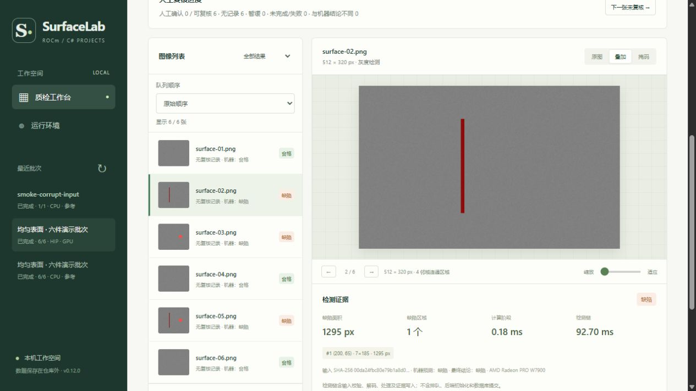
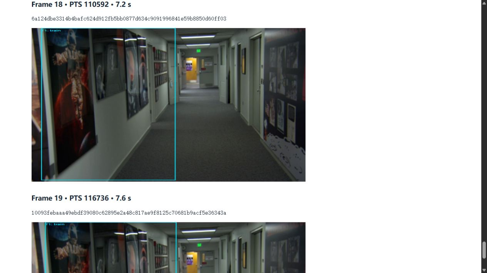

# Issue #2 补充：实际截图与四应用复跑

> 本文件是 2026-11-20 第三轮的历史记录。后续第五轮完成四案例真实数据运行，第六轮简化 OCR，第七轮增加新检出验证与原生 C# 窗口截图。最新范围见[真实数据与截图](真实开源数据案例与截图.md)和[逐项验收对照](issue-2-当前验收对照.md)。下方第三轮原始记录不代表最新正文选图。

本轮接着 `a5aeb7d` 完成截图和四应用执行，保留七章正文、六张原概念图与第二轮全部原始记录。**四应用已经运行，不等于四应用所有 GPU 模型通过或生产验收完成。**

| 项目 | 本轮实际结果 | 证据（均在 round3） |
| --- | --- | --- |
| 核心计算与推理 | VectorAdd 65,539 元素、3 次、误差 0；Identity 和 Affine/ReLU 4,096 元素通过；Compile/RunTrace 重跑成功 | `logs/core-verify.log`、`logs/core-trace.log`、`results/core-*.json` |
| SurfaceLab | 六图 HIP HTTP 流程通过，掩码与 CPU 逐字节一致；复核记录、过期版本拒绝、坏图保留、ZIP 导出通过。实验 patchbank 模型 Compile 两次访问冲突 | `results/surface-smoke-hip.json`、CPU/HIP 批次及导出包、`logs/surface-server-retry.log` |
| SignalDiagnostics | 125 窗、64,125 个 PSD 值全部在预设容差内，最大绝对差 7.4037447e-9；CPU/HIP 均 15 窗待复核 | `results/signal-comparison.json`、两份完整 `result.json`、输入/配置及原始日志 |
| DocumentEvidence | 作者夹具的导入、金额规则、修改、修订历史和报告导出完成。PP-OCRv3 GPU Compile 访问冲突，未输出本轮识别结果 | `logs/document-cpu-workflow-demo.log`、`results/document-cpu-demo/`、`results/document-gpu-alias-fixed/cli.log` |
| VideoEventSearch | 冻结 NASA 20 帧实际 MIGraphX GPU 推理完成，2 条检测、0 个候选事件，原 PTS 保留 | `results/video-gpu/workflow-run.json`、`analysis/result.json`、20 帧报告 |
| 构建/测试 | 隔离源码快照 Release 构建 0 警告/0 错误，四组测试共 264 项通过 | `logs/build.log`、`logs/tests.log`、`test-results/*.trx` |

Signal 输入是作者合成的 4096 Hz 双频信号，不是设备诊断数据。文档 demo 的 `ApprovedByHuman` 是程序沿用的状态名称，实际由 demo-reviewer 脚本演示修改，不是独立真人业务审批，更不是失败 OCR 的替代输出。初始与最终报告均保留。

视频前段含片头；本轮未重新抽帧，只重新核验冻结素材并实际执行 GPU。第 18、19 帧把走廊识别为 `train`，**这是保留的错误预测**，见原帧截图。没有独立事件标注，不报告精确率/召回率；0 候选不代表视频没有真实事件。原生日志中的 `hipErrorInvalidKernelFile` / MIOpen 诊断亦保留，最终退出 0 不意味着全程无异常。

## 截图中止如何解决

旧 Windows 辅助工具无法可靠识别 Edge URL 后已停止输入。本轮使用浏览器专用接口直接绑定完整的本地 URL，读回实际地址与页面状态，再保存真实截图。**解决的是本任务的可靠截图路径，没有宣称修复旧 Edge 辅助工具。** 没有继续向地址不明的 Edge 窗口输入。

本轮保存的是实际浏览器**视口**截图，包含 SurfaceLab 工作台、三个 CLI 应用导出的实际 HTML 报告，以及原始日志阅读页。没有全桌面/终端窗口截图。日志阅读页逐字 HTML 转义原始标准输出，明确标注“不是终端截图”，没有模拟终端、改写预测或数字。YOLOX 照片报告呈现的是上一轮实跑结果，本轮只截图，未再跑该照片。

`fullPage` 接口的两张截图出现窄版排版异常，原字节保留并标 `INVALID_LAYOUT`，未用于正文。后续用受支持的视口截图接口完成采集。截图的 URL、SHA256、日期、尺寸、对应日志/数据、素材范围见[截图清单](validation/round3/screenshots/manifest.json)。

*真实工作台，确定性合成六图的 HIP 规则结果；不是实验模型热图。*

*NASA 视频第 18 帧、PTS 110592 / 7.2 秒。train 框由真实程序产生，错误预测未修图。素材仅用于技术结果分析，不代表 NASA 认可项目。*

## 两项模型失败与路径处理

SurfaceLab 的实验 `visa-pcb1-patchbank-v1` 和文档 PP-OCRv3 均在 `MIGraphXProgram.Compile` 出现 `0xC0000005`。SurfaceLab 换回历史配置的原生路径后仍失败；该 DLL 与文章 Runtime 副本 SHA256 相同。**ROOT CAUSE UNKNOWN**，没有证据确认是封装、Windows 引擎、依赖、算子或上游的哪一层，未改源码、模型或静默回退来制造通过。

文档最初两次运行被应用的“任意 Git 祖先目录内不写输出”规则拒绝，原始退出/日志保留。所有成果必须放文章目录，而文档应用的原规则比“应用源码只读”更严格，因此临时使用一个盘符别名指向本轮证据目录。原 evaluator 会解析回物理目录，另加随文适配器只保留输出别名并验证物理路径不在应用源码快照内；GPU 调用、模型、输入、CPU 参考校验和评分代码均沿用原 evaluator。它不是干净的未改编排 Quickstart。别名只改变运行时路径，实际写入仍全部位于 `ROCmArticle`，结束后撤销映射。

模型、源码提交、构建 DLL、执行脚本与 native hash 见 `validation/round3/source-binary-hashes.json` 和 `inputs/`。完整命令与每次退出码见 `commands.json`，不覆盖失败日志。Surface HIP 与视频阶段曾重叠，汇总文件写入时丢失 Surface HIP 一行，已依据实际调用、退出 0 输出与未改的原日志恢复；时间用日志创建/修改时间，明确不是原进程精确时间。现另存逐命令记录，避免汇总覆盖造成证据丢失。来源及许可见[素材说明](validation/round3/inputs/README.md)。

## 资料版本与仍未验证的范围

本轮数据目录为 `validation/round3/`。`round2/` 的“未截图 / NOT RE-RUN”描述是 `a5aeb7d` 时的历史状态，未重写该目录的原始文件或清单。第二轮清单中正文等文件的哈希应在该提交核验；本轮清单另记当前文稿和证据，检查同时核对第二轮原始数据未变。

冷缓存、独立逐 Kernel Profiler、进程峰值显存、其他 GPU/平台、原生 Linux/KFD、小 INT8 仍未本轮复验。两项模型编译失败、SurfaceLab 质量目标、真实文档/视频精度及生产验收继续保留为未完成范围。未给 Issue #2 发评论或关闭 Issue。
